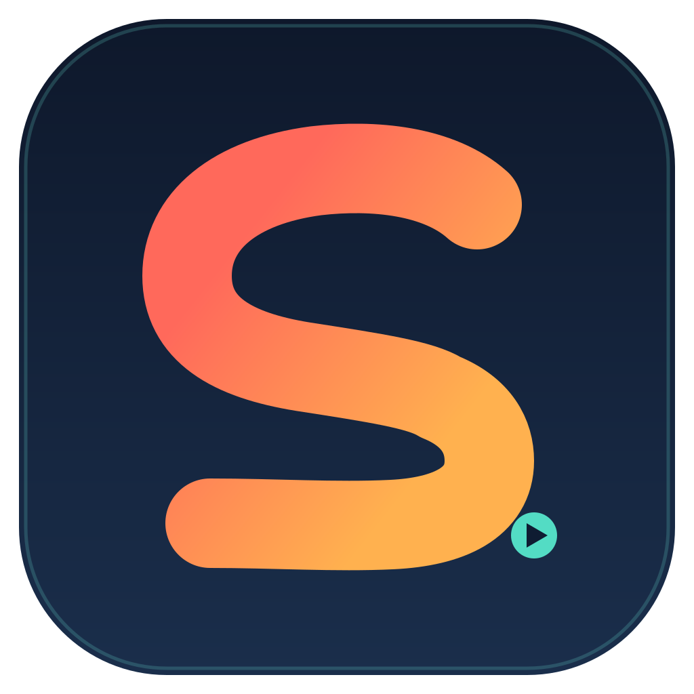
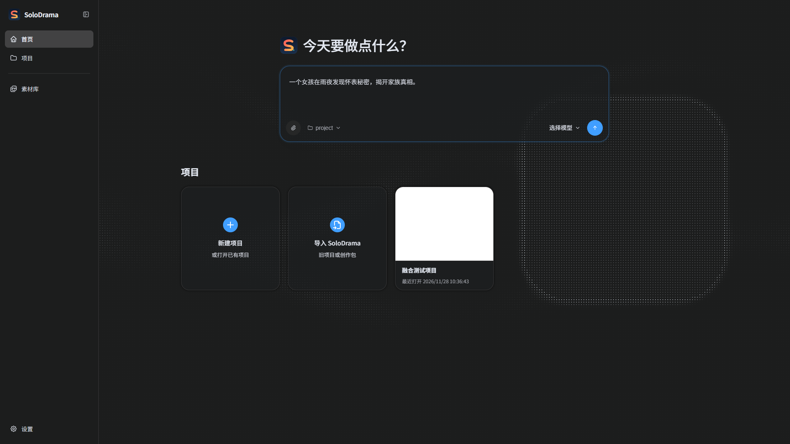
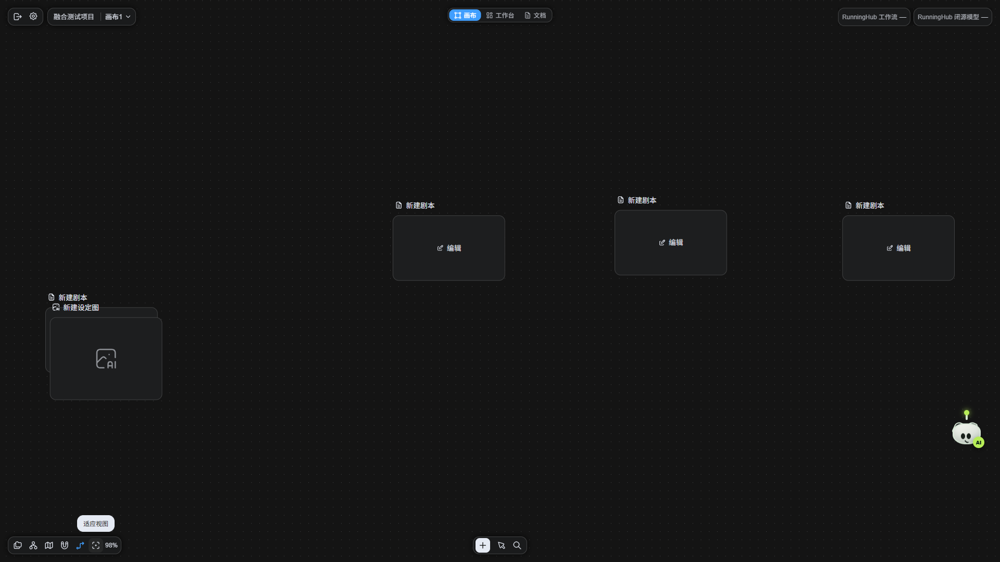
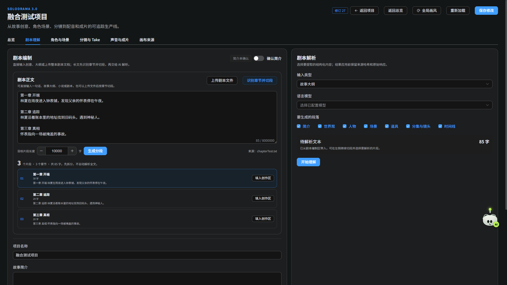
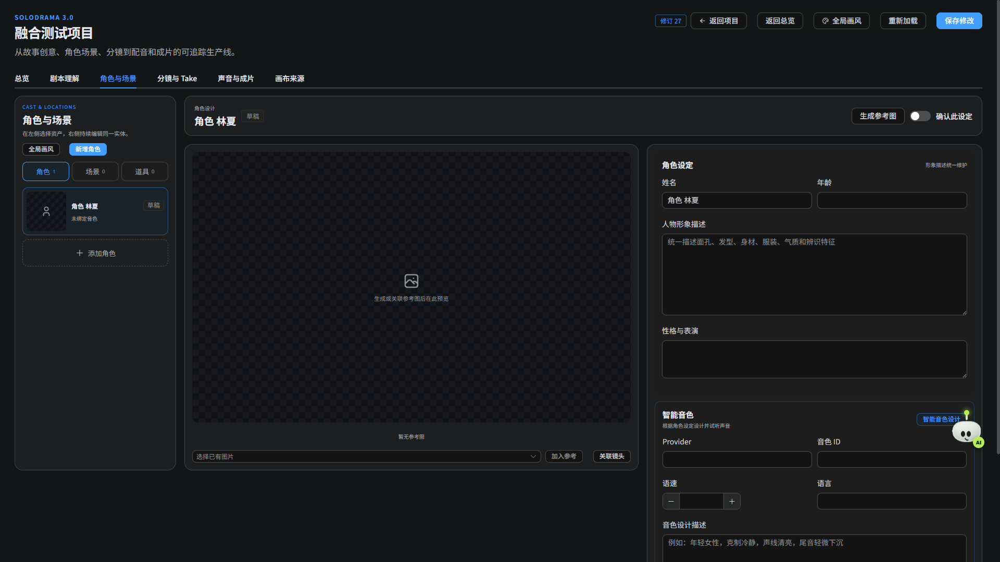
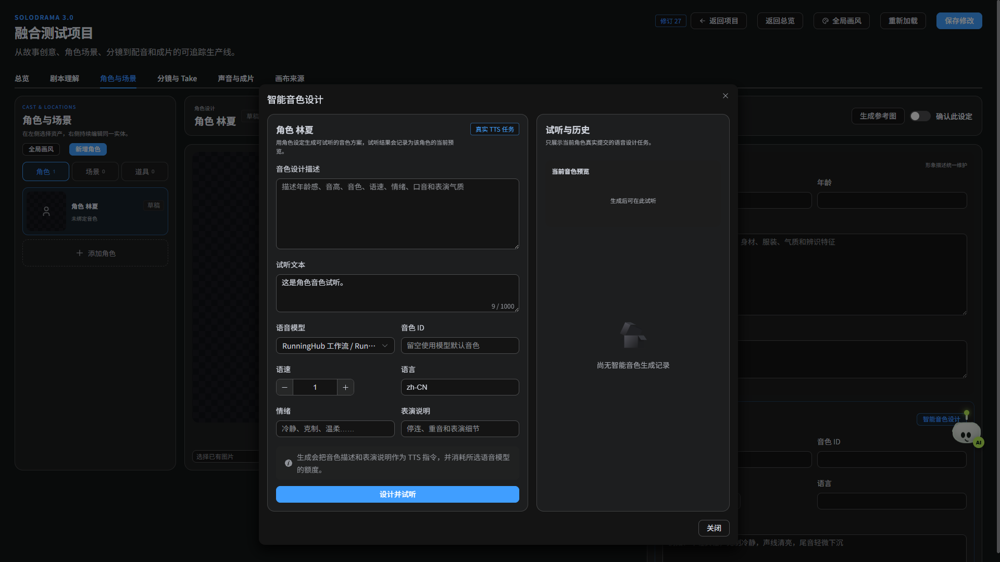
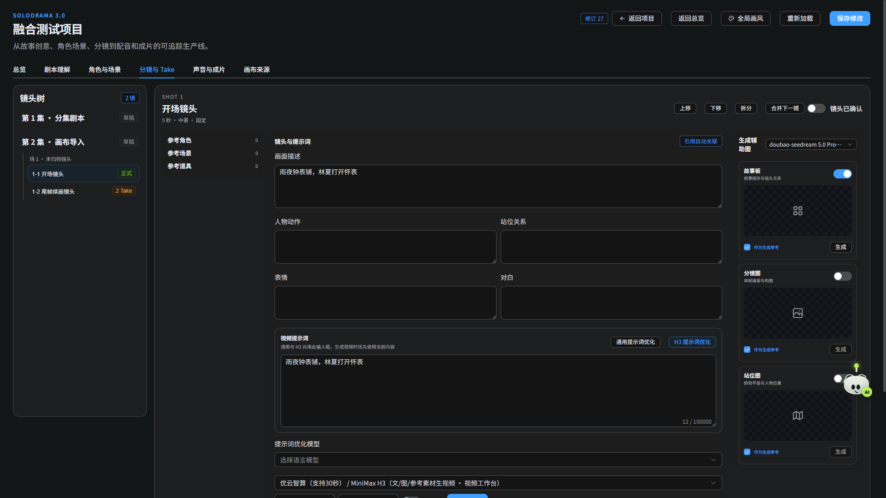
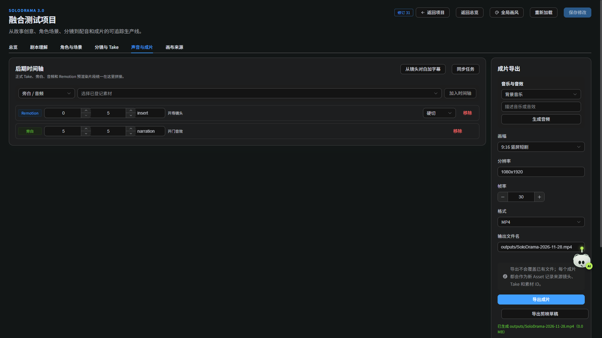

<div align="center">
  
  <h1>SoloDrama</h1>
  <p><strong>A desktop AI production platform from story idea to playable short drama</strong></p>
  <p>Script · Assets · Storyboard · Takes · Sound · Timeline · Final Cut</p>
  <p><strong>English</strong> | <a href="./README.md">简体中文</a></p>
</div>

SoloDrama is an AI creative application for vertical short dramas, comic dramas, and serialized content production. It brings script authoring and analysis, character and location assets, storyboard design, ComfyUI generation tasks, Take versioning, voice production, pre-rendered Remotion clips, video assembly, and Jianying draft export into one project workspace.

You can validate an idea with a single shot or build a complete episode or season with persistent assets and production records. Project data, generated outputs, human confirmations, and task references keep stable IDs instead of depending on any single model call.

## SoloDrama 3.0 Highlights

- **Desktop launcher**: launch with a double-click and enter the workspace after a short branded startup screen. First launch and startup failures show the full runtime state, while advanced users can open the launch control center at any time.
- **Unified workspace**: the former standalone production page is now part of the workbench, with clear switching between Canvas, Workbench, and Documents.
- **Short-drama production engine**: script, characters, locations, props, voices, global visual style, storyboards, Takes, narration, timeline, final video, and Jianying drafts.
- **Universal ComfyUI hub**: local, LAN, and cloud ComfyUI instances share one instance, workflow, capability, and task protocol.
- **Recoverable tasks**: Task Runtime stores task IDs, ProviderTaskData, and output state. Closing the launcher or restarting the app does not cancel already submitted cloud tasks.
- **Data protection**: application files, user configuration, project data, logs, and credentials are managed separately. Upgrade and repair operations do not clear user projects.

## Production Flow

```text
Story idea
  → Script authoring / long-form upload / chapter segmentation
  → Script analysis
  → Characters, locations, props, voices, and global visual style
  → Director storyboard, references, and video prompts
  → First frame / last frame / video Takes
  → Voice-over, narration, subtitles, Remotion clips
  → Timeline assembly
  → Final video export / Jianying draft
```

Every production entity has a stable ID. AI generation creates versions or Takes and does not automatically overwrite content confirmed by the user.

## Interface Preview

### Project Home

Start with a single sentence, open an existing workspace, or import a legacy SoloDrama project.



### Infinite Canvas

Text, images, video, audio, generation nodes, and the 3D director stage can be combined on one canvas.



### Script Authoring and Analysis

Enter text directly, upload a long document, detect chapters, segment the source, and analyze the structured result.



### Characters, Locations, and Intelligent Voice Design

Assets use a list-and-designer layout. Voice design runs through the existing media task system and is bound directly to a character.





### Storyboard, Prompts, and Takes

The storyboard workspace organizes references, visual descriptions, video prompts, helper images, tasks, and Take versions.



### Narration, Timeline, and Final Video

The timeline supports official Takes, narration, subtitles, Remotion or pre-rendered clips, final rendering, and Jianying draft export.


## Core Capabilities

### Script and Structured Understanding

- Enter a one-line idea, outline, novel, or complete script directly.
- Upload TXT, Markdown, DOCX, PDF, and EPUB files.
- Detect chapter structure and segment long documents before analysis instead of sending an entire novel in one request.
- Produce synopsis, worldbuilding, characters, relationships, timeline, episodes, scenes, and shot structure.
- Support manual editing, partial regeneration, source traceability, and confirmation state.

### Character, Location, and Visual Assets

- Character visual profiles covering face, hair, body, clothing, age, and identifying features.
- Location structure, time of day, lighting, color, and atmosphere.
- Prop definitions, reference image collections, and multiple clothing versions.
- Intelligent voice design with descriptions, preview text, emotion, performance notes, and real TTS tasks.
- A global visual style that is carried into script, asset, and shot prompts.

### Storyboard and Takes

- Automatically split Scenes into Shots, with manual merge, split, and reorder controls.
- Generate storyboards, shot images, blocking diagrams, first frames, and last frames.
- Edit general and H3 video prompts in one shared field with separate optimization actions.
- Keep multiple Takes per Shot with model, workflow, references, parameters, timing, and output metadata.
- Only the selected official Take enters the final timeline; older Takes remain available.
- Extract a previous Take's last frame and continue it into the next Shot.

### Sound and Post-Production

- Route dialogue, narration, music, and sound effects onto audio tracks.
- Generate subtitles and edit text and duration manually.
- Add rendered Remotion videos as timeline clips.
- Assemble video clips, mix audio, and export MP4/MOV from the timeline.
- Reuse the existing Jianying draft tool for episode or season drafts.

### Agent, Skills, and Plugins

- Agents can read project, node, document, and asset context.
- Skills support global, workspace, and project-level directing constraints.
- Tools can access files, canvas, browser, network, FFmpeg, and the asset library.
- Plugins keep host boundaries intact so plugin-specific logic stays out of core business code.

## Providers and Model Integration

| Type | Current support |
| --- | --- |
| Language models | OpenCode Go, Command Code, DeepSeek, OpenAI Chat Completions-compatible services, Ollama, and local models |
| ComfyUI | Local, LAN, and cloud instances; UI/API workflow JSON; multiple named workflows and input mappings |
| RunningHub | AI Apps, closed-source models, China/international sites, task recovery, and balance queries |
| CompShare | Image, video, multimodal models, and multiple provider channels |
| TTS | OpenAI TTS-compatible endpoints, local/self-hosted IndexTTS 2.5, and third-party speech APIs |
| Post-production | FFmpeg, Jianying drafts, project budgets, cover design, and pipeline rendering |

Cloud ComfyUI supports instance health checks, node capability probing, priority, and queue-length scheduling. Queued tasks can be removed precisely; when no reliable targeted cancellation capability exists for a running task, SoloDrama only stops local waiting and does not issue a global interrupt without a target ID.

Provider registration links:

- [Xiangong Cloud](https://www.xiangongyun.com/register/PNLH4L)
- [CompShare](https://passport.compshare.cn/register?referral_code=2UZNw7j4pcEExqFlumDrU)
- [RunningHub China](https://www.runninghub.cn?inviteCode=cn-v1122)
- [RunningHub International](https://www.runninghub.ai/zh-cn?inviteCode=rh-v1727)

## Quick Start

### Desktop Users

Install SoloDrama and double-click the application icon. A normal launch shows a short branded startup screen and enters the workspace when the local service is ready. Open the launch control center on first launch, after a failure, or when logs and diagnostics are needed.

### Run from Source

Requirements:

- Bun 1.4.3
- Optional FFmpeg for audio assembly, video processing, and final rendering

```powershell
bun install --frozen-lockfile
bun run dev
```

Or build and start the standalone server:

```powershell
bun install --frozen-lockfile
bun run build
bun run start:server
```

Default URL:

```text
http://127.0.0.1:3000
```

## Data and Upgrades

- Project domain data: `.solodrama/production.json` inside the workspace
- Generated assets: `assets/production/*` by default
- User projects: managed by the workspace directory, never stored in replaceable application resources
- Runtime logs: written by the launcher to a separate log directory
- Provider configuration and credentials: stored through the existing settings and secret-management mechanisms

Upgrades, repairs, and restarts do not automatically remove projects, workflows, provider configuration, assets, or logs. Submitted cloud tasks are persisted by Task Runtime and can be verified or resumed after the next launch.

## Documentation

- [SoloDrama 3.0 Production Guide](./docs/guides/SOLODRAMA-PRODUCTION-GUIDE.md)
- [Cloud ComfyUI Connection Guide](./docs/guides/CLOUD-COMFYUI-CONNECTION-GUIDE.md)
- [Workflow Import and Sync Guide](./docs/guides/WORKFLOW-IMPORT-AND-SYNC-GUIDE.md)
- [Launcher User Guide](./docs/guides/SOLODRAMA-LAUNCHER-USER-GUIDE.md)
- [Provider Integration Reference](./docs/SOLODRAMA-PROVIDERS.md)
- [3.0 Production Architecture](./docs/architecture/SOLODRAMA-3.0-PRODUCTION-DESIGN.md)
- [3.0 Acceptance Report](./docs/quality/SOLODRAMA-3.0-ACCEPTANCE-REPORT.md)

## Importing Legacy Projects

Legacy SoloDrama projects can be imported into a new canvas project while preserving scripts, storyboards, characters, locations, props, shot images, videos, and reference relationships.

```powershell
python migration/import-solodrama-project.py `
  --source "D:\path\to\old-solodrama" `
  --output "D:\path\to\new-solodrama-project"
```

Migration is one-way and does not write back to the legacy project.

## License

Apache-2.0
