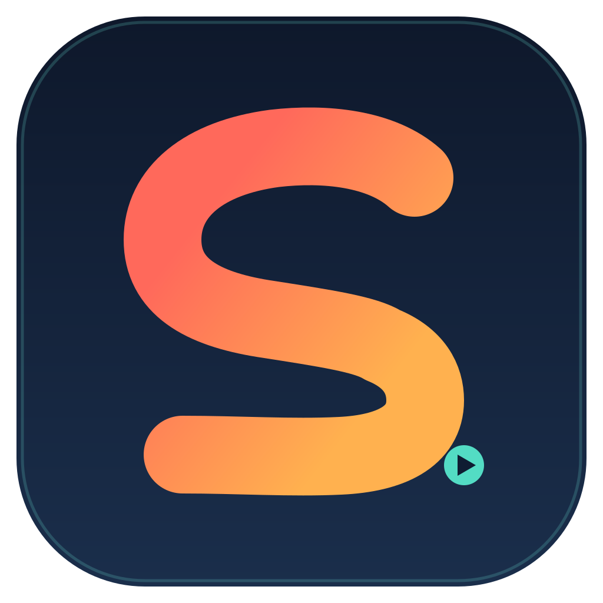
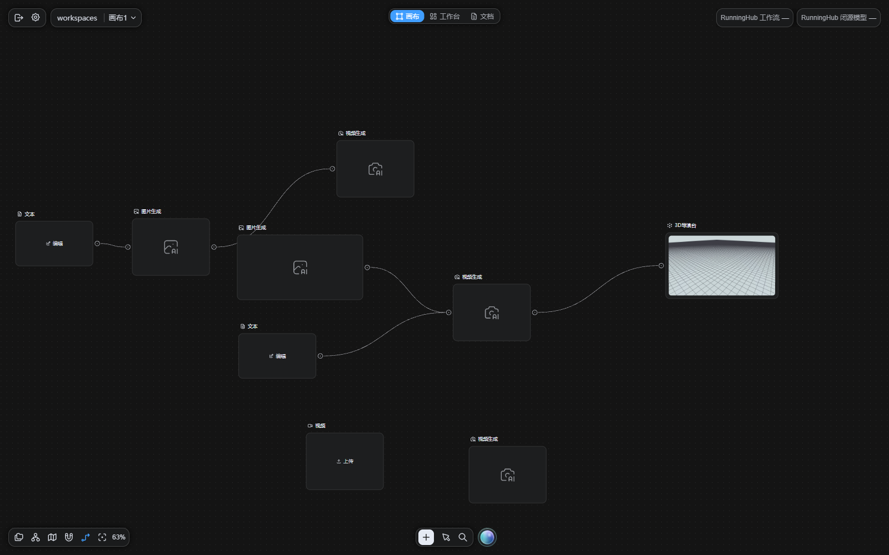
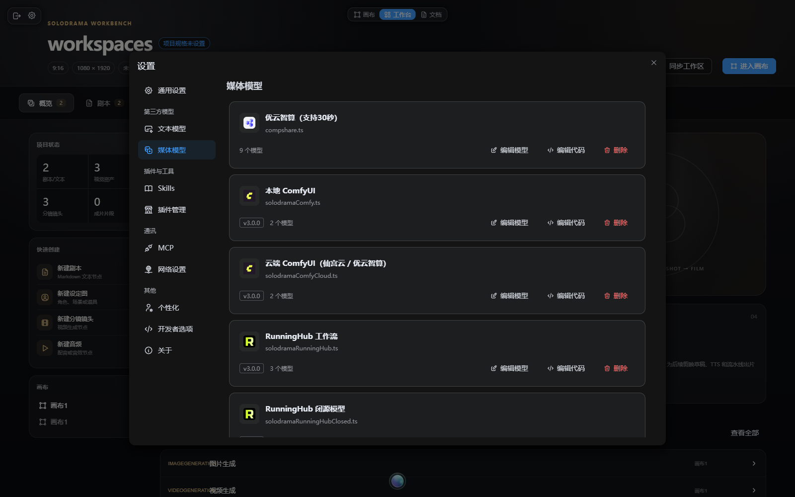
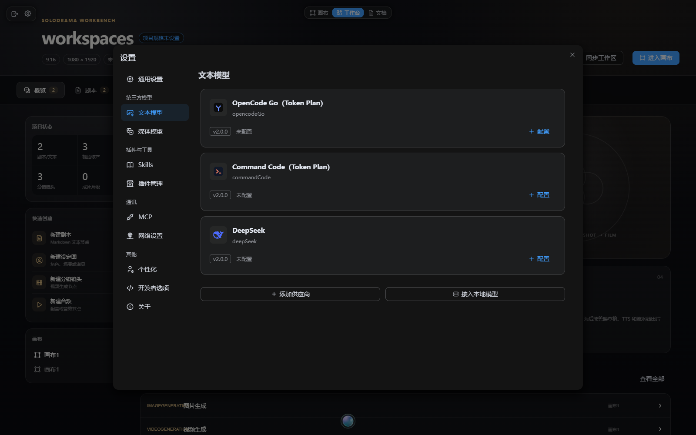
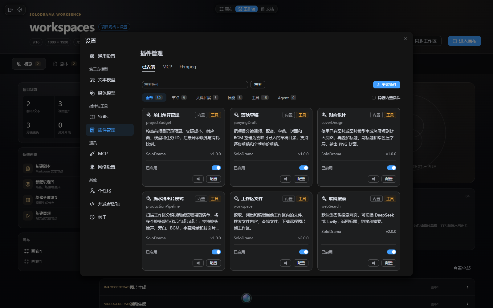

<div align="center">
  
  <h1>SoloDrama</h1>
  <p><strong>从故事创意到可播放短剧的桌面 AI 制作平台</strong></p>
  <p>剧本 · 资产 · 分镜 · Take · 声音 · 时间轴 · 成片</p>
  <p><a href="./README.en.md">English</a> | <strong>简体中文</strong></p>
</div>

SoloDrama 是一套面向竖屏短剧、漫剧和连续内容生产的 AI 创作软件。它把剧本编制与解析、角色和场景资产、分镜设计、ComfyUI 生成任务、Take 版本管理、配音、Remotion 预渲染片段、视频拼接和剪映草稿放进同一个项目空间。

你可以用一个镜头快速验证想法，也可以围绕一集或多集内容持续组织正式资产和生产任务。项目数据、生成结果和人工确认状态都会保留稳定 ID，不依赖某一次模型调用。

## SoloDrama 3.0 重点

- **桌面启动器**：双击启动，短暂显示启动画面后进入工作台；首次启动和启动失败时显示完整运行状态，高级用户可主动打开启动控制中心。
- **统一工作台**：原“制作”已并入工作台，通过“画布 / 工作台 / 文档”切换，不再维护两套割裂的生产入口。
- **短剧生产引擎**：覆盖剧本、角色、场景、道具、音色、画风、分镜、Take、旁白、时间轴、成片和剪映草稿。
- **通用 ComfyUI 接入中心**：本地、局域网和云端 ComfyUI 使用统一实例、工作流、能力检测和任务协议。
- **可恢复任务**：Task Runtime 保存 taskId、ProviderTaskData 和输出状态；关闭 Launcher 或重启软件不会误取消已经提交的云端任务。
- **数据保护**：程序文件、用户配置、项目数据、日志和密钥分别管理；升级和修复不清理用户项目。

## 生产流程

```text
故事创意
  → 剧本编制 / 上传长文 / 章节切段
  → 剧本解析
  → 角色、场景、道具、音色与全局画风
  → 导演分镜、参考图与视频提示词
  → 首帧 / 尾帧 / 视频 Take
  → 配音、旁白、字幕、Remotion 片段
  → 时间轴拼接
  → 成片导出 / 剪映草稿
```

所有正式实体使用稳定 ID。AI 生成只新增版本或 Take，不自动覆盖用户已经确认的内容。

## 界面预览

### 项目首页

从一句话开始创建项目，也可以打开已有工作目录或导入旧 SoloDrama 创作包。


### 统一工作台

工作台按剧本解析、提取资产、设计分镜和旁白成片组织项目，并读取画布和文档中的现有来源。


### 无限画布

文本、图片素材、图片生成、视频素材、视频生成、音频生成和 3D 导演台可以在同一张画布中组合连线。



### 媒体模型

本地 ComfyUI、云端 ComfyUI、RunningHub、优云智算和 TTS 在媒体模型页统一管理。



### 文本模型

支持 OpenCode Go、Command Code、DeepSeek、自定义 OpenAI 兼容服务和本地模型。



### 创作插件

内置项目预算、剪映草稿、封面设计、流水线出片、工作区文件和联网搜索等插件。



## 核心能力

### 剧本与结构化理解

- 直接输入一句话创意、故事大纲、小说或完整剧本。
- 上传 TXT、Markdown、DOCX、PDF、EPUB 文件。
- 长文先识别章节分布，再按目标长度切段，不要求一次解析整本小说。
- 输出故事简介、世界观、人物、关系、时间线、分集、场景和镜头结构。
- 支持人工编辑、局部重生成、来源追溯和确认状态。

### 角色、场景与视觉资产

- 角色视觉档案：面部、发型、身材、服装、年龄和辨识特征。
- 场景空间结构、时间、光线、色彩和氛围设定。
- 道具设定、参考图集合和多版本服装。
- 智能音色设计：音色描述、试听文本、情绪、表演说明和真实 TTS 任务。
- 全局画风统一进入剧本、资产和镜头提示词。

### 分镜与 Take

- 从 Scene 自动拆解 Shot，也可人工合并、拆分和调整顺序。
- 每个 Shot 可生成故事板、分镜图、站位图、首帧和尾帧。
- 通用提示词与 H3 提示词共用一个编辑框，可选择不同优化方式。
- 每个 Shot 可保留多个 Take，记录模型、工作流、参考素材、参数、耗时和输出。
- 只有被选中的正式 Take 进入最终时间轴，旧 Take 不会被删除。
- 支持尾帧自动提取并续接到下一镜头。

### 声音与后期

- 角色对白配音、旁白、音乐和音效统一进入音频轨。
- 自动生成字幕，可人工修改文本和时长。
- 支持将 Remotion 输出的视频作为片段加入时间轴。
- 按时间轴拼接视频、混合音频并导出 MP4/MOV。
- 复用现有剪映草稿工具生成逐集或整季草稿。

### Agent、Skills 与插件

- Agent 可以读取项目、节点、文档和素材上下文。
- Skills 支持全局、工作区和项目级约束。
- Tools 可访问文件、画布、浏览器、网络、FFmpeg 和资源库。
- 插件保持宿主与插件边界，不把插件专属逻辑混入核心业务。

## Provider 与模型接入

| 类型 | 当前支持 |
| --- | --- |
| 文本模型 | OpenCode Go、Command Code、DeepSeek、OpenAI Chat Completions 兼容服务、Ollama 和本地模型 |
| ComfyUI | 本地、局域网、云端实例；UI/API 工作流 JSON；多命名工作流和输入映射 |
| RunningHub | AI App、闭源模型、国内站、国际站、任务恢复和余额查询 |
| 优云智算 | 图片、视频、多模态模型和多通道配置 |
| TTS | OpenAI TTS 兼容接口、本地/自建 IndexTTS 2.5、第三方语音 API |
| 后期工具 | FFmpeg、剪映草稿、项目预算、封面设计和流水线出片 |

云端 ComfyUI 支持实例健康检查、节点能力探测、优先级和队列长度调度。排队任务可精确删除；运行中任务在没有可靠定向取消能力时只停止本地等待，不会发送无目标 ID 的全局中断。

Provider 注册入口：

- [仙宫云](https://www.xiangongyun.com/register/PNLH4L)
- [优云智算](https://passport.compshare.cn/register?referral_code=2UZNw7j4pcEExqFlumDrU)
- [RunningHub 国内站](https://www.runninghub.cn?inviteCode=cn-v1122)
- [RunningHub 国际站](https://www.runninghub.ai/zh-cn?inviteCode=rh-v1727)

## 快速开始

### 桌面用户

安装后双击 SoloDrama 图标即可启动。正常启动会显示短暂品牌启动画面，服务就绪后自动进入工作台。首次启动、启动失败或需要查看日志时，可打开启动控制中心。

### 源码运行

环境要求：

- Bun 1.4.3
- 可选 FFmpeg，用于音频拼接、视频处理和成片导出

```powershell
bun install --frozen-lockfile
bun run dev
```

也可以构建后启动独立服务：

```powershell
bun install --frozen-lockfile
bun run build
bun run start:server
```

默认访问地址：

```text
http://127.0.0.1:3000
```

## 数据与升级

- 项目领域数据：工作区内 `.solodrama/production.json`
- 生成素材：默认 `assets/production/*`
- 用户项目：由工作区目录管理，不写入可被升级替换的程序文件
- 运行日志：由 Launcher 写入独立日志目录
- Provider 配置与密钥：使用现有设置和密钥管理机制保存

升级、修复和重启不会自动清理项目、工作流、Provider 配置、素材和日志。已经提交的云端任务保存在 Task Runtime 中，下次启动后可以继续核实和恢复。

## 文档

- [SoloDrama 3.0 短剧制作指南](./docs/guides/SOLODRAMA-PRODUCTION-GUIDE.md)
- [云 ComfyUI 接入指南](./docs/guides/CLOUD-COMFYUI-CONNECTION-GUIDE.md)
- [工作流导入与同步指南](./docs/guides/WORKFLOW-IMPORT-AND-SYNC-GUIDE.md)
- [Launcher 用户指南](./docs/guides/SOLODRAMA-LAUNCHER-USER-GUIDE.md)
- [Provider 接入说明](./docs/SOLODRAMA-PROVIDERS.md)
- [3.0 生产架构设计](./docs/architecture/SOLODRAMA-3.0-PRODUCTION-DESIGN.md)
- [3.0 验收报告](./docs/quality/SOLODRAMA-3.0-ACCEPTANCE-REPORT.md)

## 旧项目导入

可以把旧 SoloDrama 项目中的剧本、分镜、角色、场景、道具、分镜图、视频和参考图关系导入为新的画布项目。

```powershell
python migration/import-solodrama-project.py `
  --source "D:\path\to\old-solodrama" `
  --output "D:\path\to\new-solodrama-project"
```

导入为单向迁移，不会回写旧项目。

## 许可证

Apache-2.0
