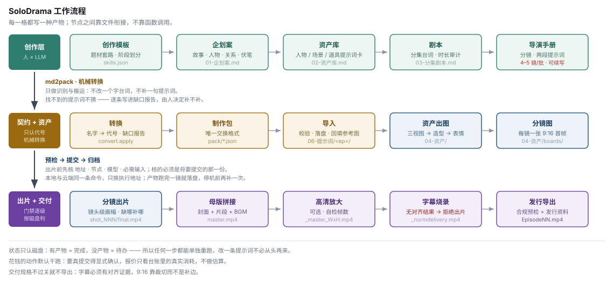

  

# SoloDrama

**把一句话点子做成可发布竖屏短剧的流水线。**

创作交给可插拔的题材模板，执行交给本机或云端的 ComfyUI，两者之间只隔一份文件契约 ——
所以换一套题材模板，引擎一行不用改。

  

---

## 能做什么

| 能力 | 说明 |
| --- | --- |
| **创作** | 21 套题材模板（宅斗 / 甜宠 / 重生 / 悬疑…），产出企划案、资产库、分集剧本、导演手册。分批生成，可续写，镜号不重复 |
| **资产** | 人物 / 场景 / 道具批量出图。三视图、造型、表情、状态分层管理，先定三视图再换装，同一个角色不换脸 |
| **分镜** | 每镜一张 9:16 首帧；镜头级画幅、时长、参考图顺序都可单独控制 |
| **出片** | 本地 ComfyUI（￥0）或云端主机，同一条命令；中断续跑，缺哪镜补哪镜，不重复提交 |
| **交付** | 母版 → 放大 → 字幕 → 合规预检 → `EpisodeNN.mp4`。字幕必须有对齐证据，规格不过关不导出 |

整个执行层跑在 **RTX 4060（8G 显存）+ 16G 内存的笔记本**上，不需要工作站。

---

## 效果

*资产卡：4 个角色各 4 视图（正 / 侧 / 背 / 特写）+ 场景。四视图是后续所有镜头的共同锚点 —— 换集不换脸靠它，不靠运气。*

*同批分镜的 3 段原帧（672×1216）。台阶 → 雨夜的车 → 车内：同一件大衣、同一场雨、同一张脸。*

*Studio 工作台：项目、待办、通道状态一屏可见。界面上每个数字都来自引擎的真实产物。*

| 实跑项目 | 产出 |
| --- | --- |
| 《离婚后，四个大佬哥哥接我回家》西语 · 竖屏 · 40 集 | ep02–ep40：**261 个生成段 / 1853 秒画面**，逐集出片并记台账 |
| 《七大姑催婚》ep03–ep10 | **64 段 / 172 条字幕 / 792 秒成片**，字幕全量烧录 |
| 《贤妻不装了》 | 81/81 参考图全量出图 |

---

## 工作流程

| 阶段 | 做什么 | 产物 |
| --- | --- | --- |
| **1 创作** | 选模板 → 企划案 → 资产库 → 剧本 → 导演手册，每步可续写 | `00-创作/*.md` |
| **2 转换** | 把创作稿机械转成制作包：名字换代号、抽提示词、列缺口 | `pack/*.json` |
| **3 导入** | 校验制作包（缺集 / 缺资产 / 缺提示词全阻断）→ 落成引擎契约 → 回填参考图 | `06-提示词/<ep>/` |
| **4 出图** | 资产图（分层）→ 分镜图（每镜一张首帧） | `04-资产/` |
| **5 出片** | 预检 → 提交 → 逐镜落盘；本地或云端同一个执行器 | `shot_NNN/final.mp4` |
| **6 交付** | 母版 → 放大 → 字幕 → 合规 → 导出发布版 | `09-发行/剧集/EpisodeNN.mp4` |

**四道贯穿全流程的约束**

- **状态只认磁盘**：有产物 = 完成，没产物 = 待办。所以任何一步都能单独重跑，改一条提示词不必从头再来。
- **花钱的动作默认干跑**：要真提交得显式确认，报价只看台账里的真实消耗，不做估算。
- **核的必须是将要提交的那一份**：预检、干跑、真跑读同一份配置，避免「核 A 跑 B」。
- **规格不过关就不导出**：字幕必须有对齐证据，9:16 靠裁切而不是补边。

实现细节与设计取舍见 [`docs/`](docs/)，版本记录见 [VERSIONS.md](VERSIONS.md)。

---

## License

[Apache-2.0](LICENSE)
