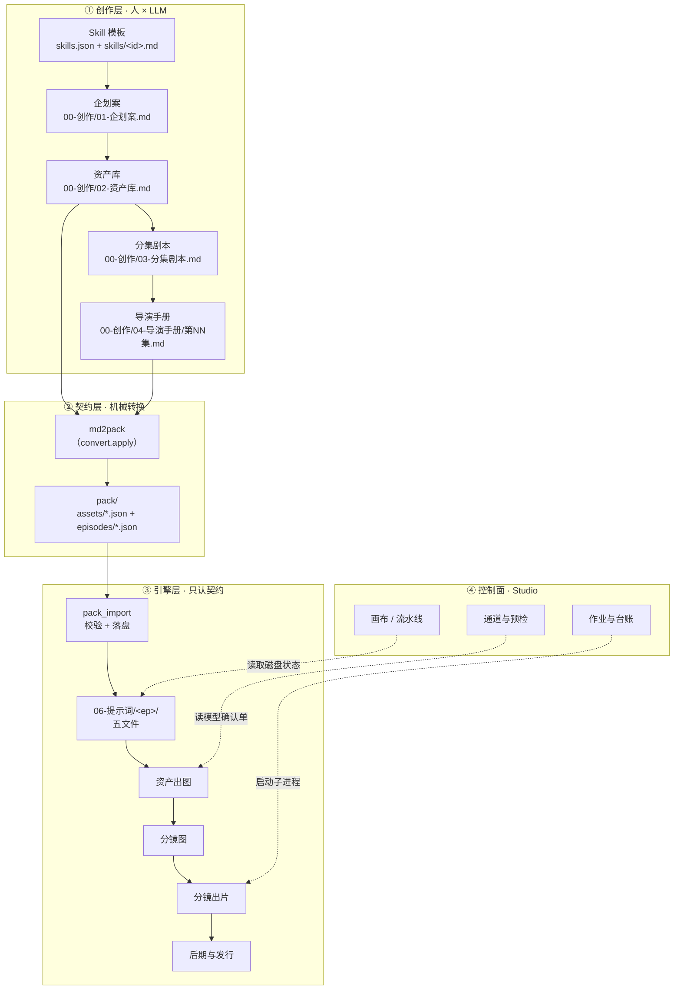
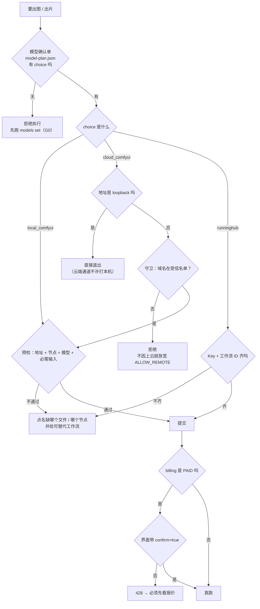
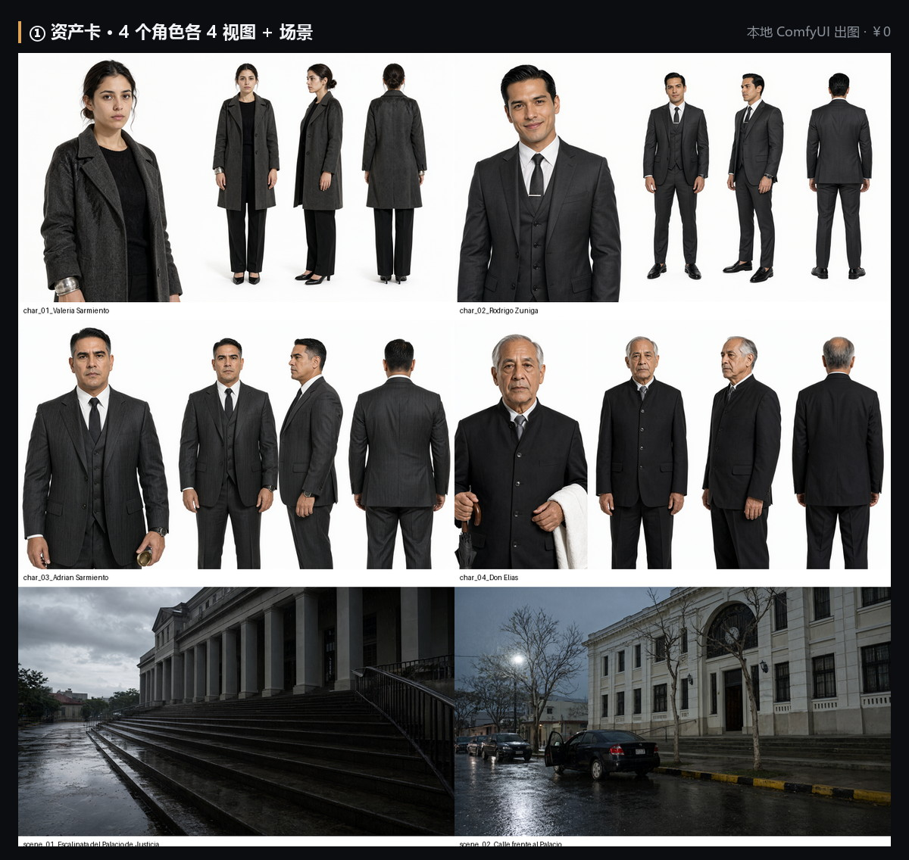
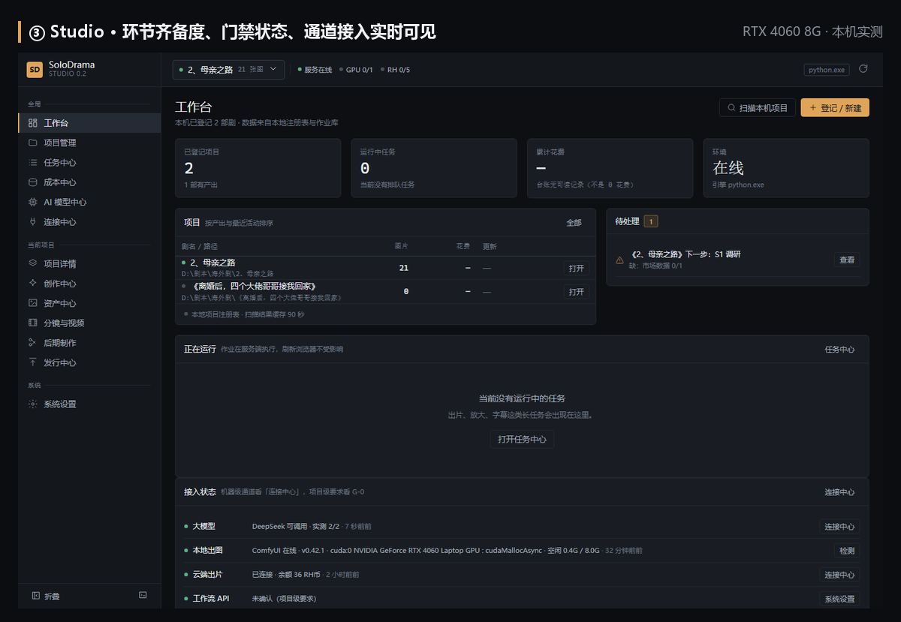

# SoloDrama

**把一句话点子做成可发布竖屏短剧的流水线。**

创作交给可插拔的题材模板，执行交给本机或云端的 ComfyUI，两者之间只隔一份文件契约 ——
所以换一套题材模板，引擎一行不用改。

在线镜像地址：[https://www.xiangongyun.com/register/PNLH4L](https://www.xiangongyun.com/image/detail/aede014f-b098-4b8a-86e0-15b5039615e7?r=PNLH4L)

runninghub主页：https://www.runninghub.cn?inviteCode=cn-v1122 

海外版RH（宽审核）：https://www.runninghub.ai/zh-cn?inviteCode=rh-v1727

---

## 装起来

**三种装法，看你在哪一边，选一条就行 —— 不用都做。**

| 你是 | 机器 | 怎么做 | 耗时 |
|---|---|---|---|
| 内容创作者 | Windows + N 卡 | 装 Python → 双击 `start.cmd`，缺什么它会问你 | ~3 分钟 |
| 开发者 | 任意 | `git clone` + 两条 `pip install` | ~2 分钟 |
| 不想自己敲命令 | 任意 | 把下面 **C** 那段整段发给 AI 助手 | ~5 分钟 |
| 只想先看看界面 | 任意 | 同「开发者」。**不接 ComfyUI 也能开工作台** | ~2 分钟 |

### 前置

| 项 | 要求 | 说明 |
|---|---|---|
| Python | 3.10+（实测 3.13） | 安装时勾 **Add Python to PATH**，否则双击只会闪一下 |
| 系统 | Windows 10/11 为主路径；macOS / Linux 可跑控制台与命令行 | 仓库里的 `.cmd` 只适用 Windows，其他平台用 `launcher.py` |
| 显卡 | 有 N 卡（≥8G 显存更稳，实测 4060 8G）→ 全链路本机、￥0 | 没有也能用：创作/审片/导出照常，出图出片走云端或平台通道 |
| ComfyUI | **不装也能启动** | 只在真正出图/出片时才需要：本机 8188，或云端地址 |
| 目录 | 放在自己有写权限的地方 | 别放 `C:\Program Files`（要管理员）；路径带空格或中文没关系，脚本都加了引号 |

### A. Windows 一键（给创作者）

1. 装 Python 3.10+，勾上 *Add Python to PATH*。
2. 把仓库放到任意目录（`git clone` 或下载 zip 解开都行）。
3. 双击 `start.cmd`。

首次启动若缺依赖，它会**列出两条路**，并问一句「要现在就自动创建环境并安装依赖吗？」——
回车即可。它在仓库下建 `envs/solodrama-web/`（已 gitignore，不入库），装
`fastapi / uvicorn / httpx`，约 1 分钟；失败会直接打印可复制的手工命令，不会停在空白窗口。

只想装环境不想启动：`start.cmd --init`。装完建议补一条，把引擎要的 `Pillow` 也放进同一个环境：

```bat
envs\solodrama-web\Scripts\python.exe -m pip install -r requirements.txt
```

不补也能开界面，只是字幕、放大、本机出图会报「引擎解释器缺 Pillow」。

### B. 手动（给开发者 / 想控制装在哪）

```bash
git clone https://github.com/Hejunlong27/SoloDrama.git
cd SoloDrama

python -m venv envs/solodrama-web

# Windows
envs/solodrama-web/Scripts/python.exe -m pip install -r web/requirements-web.txt
envs/solodrama-web/Scripts/python.exe -m pip install -r requirements.txt

# macOS / Linux
envs/solodrama-web/bin/python -m pip install -r web/requirements-web.txt
envs/solodrama-web/bin/python -m pip install -r requirements.txt
```

两份依赖是**故意分开**的：`web/requirements-web.txt` 是控制台（fastapi / uvicorn），
`requirements.txt` 是引擎（httpx / Pillow）。装进同一个 venv 最省事；分两个环境也能跑，
启动器会自己挑一个装齐了的，并在控制台里告诉你挑了哪个。

### C. 交给 AI 助手（整段复制）

不想自己敲命令，或者要在别人的机器 / 服务器上装 —— 把下面这段整段发给 AI 助手
（WorkBuddy、Claude Code 等能读文件、能执行命令的 Agent），**把尖括号里的三处换掉**：

```text
帮我把 SoloDrama 装好，直到能打开工作台。仓库：https://github.com/Hejunlong27/SoloDrama
我的机器：<Windows 11 / macOS 14 / Ubuntu 22.04>；Python：<版本，或「没装，帮我装 3.10+」>
放到：<仓库目录>；显卡：<有 N 卡 8G / 没有独显>

按顺序做，每步做完用一行报结果；卡住就停下来说清卡在哪，不要自己发明绕法：

1. 克隆仓库到 <仓库目录>。失败最多重试 3 次（网络/代理偶发断流），仍失败就报错并说明网络环境。

2. 建专用环境并装两份依赖，缺一不可：
   python -m venv envs/solodrama-web
   Windows：
     envs/solodrama-web/Scripts/python.exe -m pip install -r web/requirements-web.txt
     envs/solodrama-web/Scripts/python.exe -m pip install -r requirements.txt
   macOS / Linux：
     envs/solodrama-web/bin/python -m pip install -r web/requirements-web.txt
     envs/solodrama-web/bin/python -m pip install -r requirements.txt

3. 自检：python tools/env_check.py --json —— 把 ok 和未通过的项报给我。
   必需项只有 Python 3.10+ / Pillow / ffmpeg / ffprobe；ffmpeg 缺了就告诉我命令，别替我装系统包。

4. 离线用例：python -m pytest tools/tests stages/import/tests -q，要求全绿。
   不要在仓库根直接跑 pytest（引擎脚本导入期就要求工作区存在）。

5. 真启动一次：python web/launcher.py --no-browser，看到「依赖齐备」和端口后，
   访问一下 /studio/ 确认返回 200，再停掉。

6. 最后告诉我三件事：启动命令、默认端口、第一次进界面该点哪里。

硬性要求：
- 不 commit、不 push；别把 envs/ 加进版本库。
- 不改 stages/、web/core/ 里的代码；装不上就停下，不要改代码绕过。
- 不装 ComfyUI 也能完成安装；出图出片等我真正要用时再配。
- 任何要花钱的动作（云端实例、平台通道、放大服务）执行前先报价，等我同意。
```

它做的事和 A / B 完全一样，只是把「判断-重试-验证」交给助手。装上之后要开始做剧，
换成 [`docs/新项目启动提示词.md`](docs/新项目启动提示词.md) 里那段。
**老设备 / 低配机器**用同文件的第三节：环境已装好的前提下，先定生产模式、把免费的部分
（剧本 / 分镜 / 提示词）全做完，最后才开机一次性生成 —— 提前开实例就是白烧钱。

### 启动

| 想要 | 命令 |
|---|---|
| 图形工作台（Windows） | 双击 `start.cmd` |
| 只读演示（禁止写操作与计费） | 双击 `start-readonly.cmd` |
| 任意平台 | `python web/launcher.py` |
| 换端口 | `python web/launcher.py --port 9000` |
| 不开浏览器 | `python web/launcher.py --no-browser` |
| 给同网段同事看 | `python web/launcher.py --host 0.0.0.0`（仅可信内网） |
| 只装环境不启动 | `python web/launcher.py --init` |

默认 `127.0.0.1:8788`，端口被占会自动往后找（最多 12 个），不会报 address already in use。
启动后：`/` 跳 `/studio/` 工作台，`/ui/` 是旧控制台（命令面板与审计）。
要直接打开某一部剧：`http://127.0.0.1:8788/?ws=<剧目录>`（书签就用这个写法）。
停止 = 关窗口或 `Ctrl+C`。
服务器上也可以不改命令行，用环境变量 `SOLODRAMA_CONSOLE_HOST` / `SOLODRAMA_CONSOLE_PORT`。

### 不开界面也能跑

界面和命令行调的是同一套引擎、同一份门禁，只是入口不同：

```bash
python stages/production/scripts/drama.py init --workspace "<剧目录>" --title "剧名" --look "视觉风格"
python stages/production/scripts/drama.py --workspace "<剧目录>" status
python stages/production/scripts/drama.py --workspace "<剧目录>" next
```

**工作区放在仓库外面**，一部剧一个目录；`init` 会生成 `00-创作` … `09-发行` 的骨架与配置。

### 装完先验一遍

```bash
python tools/env_check.py                                     # 缺什么、怎么修，逐条列出
python -m pytest tools/tests stages/import/tests -q           # 不依赖工作区的离线测试
```

⚠ 不要在仓库根直接跑 `pytest`：引擎脚本导入期就要求工作区存在。逐目录跑，
`stages/production/scripts/tests` 还要先设 `SOLODRAMA_WORKSPACE=<fixtures/mini_drama>`。

### 不同机器、不同人

| 场景 | 能做什么 | 要注意 |
|---|---|---|
| Windows + N 卡 | 全链路本机跑，￥0 | 出图与出片分开阶段跑（显存装不下两套权重） |
| Windows 无独显 / 小显存 | 创作、审片、导出都能用 | 出图出片走云端或平台通道；通道必须自己选，界面不替你预选计费项 |
| macOS / Linux | 控制台 + 命令行可跑（`bin/python`、`python3 web/launcher.py`） | 出图出片要自备 ComfyUI 或云端；**引擎侧未做端到端验证** |
| 服务器 / 无显示器 | `--no-browser --host 0.0.0.0` | 对外演示加 `--readonly` |
| 同机多个账户 | 各人 clone 一份 | `envs/` 在仓库内，venv 记的是创建者的解释器路径，共用会别扭 |
| 交给 AI 助手装 | 见 [`docs/operations/使用者路线.md`](docs/operations/使用者路线.md) 的整段提示词 | 助手会先读真源再动手，你只需在「要不要花钱」处答一句 |

### 起不来，先看这三条

| 现象 | 多半是 | 修法 |
|---|---|---|
| 窗口闪一下就没了 / `Python not found` | 没装 Python，或没勾 Add to PATH | 重装并勾选；或直接 `py -3 web/launcher.py` |
| 页面白屏 / 404 | 端口被别的进程占了 | 看窗口打印的实际端口；或 `--port 9000` |
| 能开界面，出图报缺模型 | 没接 ComfyUI，或工作流要的模型本机没有 | 先跑预检：界面「通道与预检」，或 `drama preflight --only gen` |

---

## 四层结构



创作只写 markdown，引擎只读 JSON。层与层之间传文件，不传内存状态。

## 全景

```mermaid
flowchart LR
    subgraph C["创作"]
        N1["1 创作模板"]
        N2["2 灵感"]
        N3["3 企划案"]
        N4["4 资产库"]
        N5["5 剧本"]
        N6["6 导演手册"]
    end
    subgraph E["契约与引擎"]
        N7["7 转换"]
        N8["8 制作包"]
        N9["9 导入"]
        N10["10 绑定参考图"]
        N11["11 生成端门禁"]
        N12["12 资产出图"]
        N13["13 分镜图"]
        N14["14 出片解析"]
        N15["15 批量出片"]
        N16["16 出片审计"]
    end
    subgraph P["后期"]
        N17["17 母版"]
        N18["18 放大"]
        N19["19 字幕"]
        N20["20 合规"]
        N21["21 发行导出"]
    end

    N1 --> N3
    N2 --> N3
    N3 --> N4 --> N6
    N3 --> N5 --> N6
    N4 --> N7
    N6 --> N7
    N7 --> N8 --> N9 --> N10 --> N11
    N10 --> N12 --> N13
    N13 --> N14 --> N15 --> N16
    N16 --> N17 --> N18 --> N19 --> N20 --> N21
```



## 生成通道



三条路，同一个执行器、同一套预检。通道只从「模型确认单」读一次，界面与命令行不会各有各的答案。

---

## 效果



*4 个角色各 4 视图。四视图是后续所有镜头的共同锚点 —— 换集不换脸靠它。*


*同批分镜的 3 段原帧（672×1216）：同一件大衣、同一场雨、同一张脸。*



*Studio：项目、待办、通道状态一屏可见。每个数字都来自引擎的真实产物。*

---

## License

[Apache-2.0](LICENSE)
