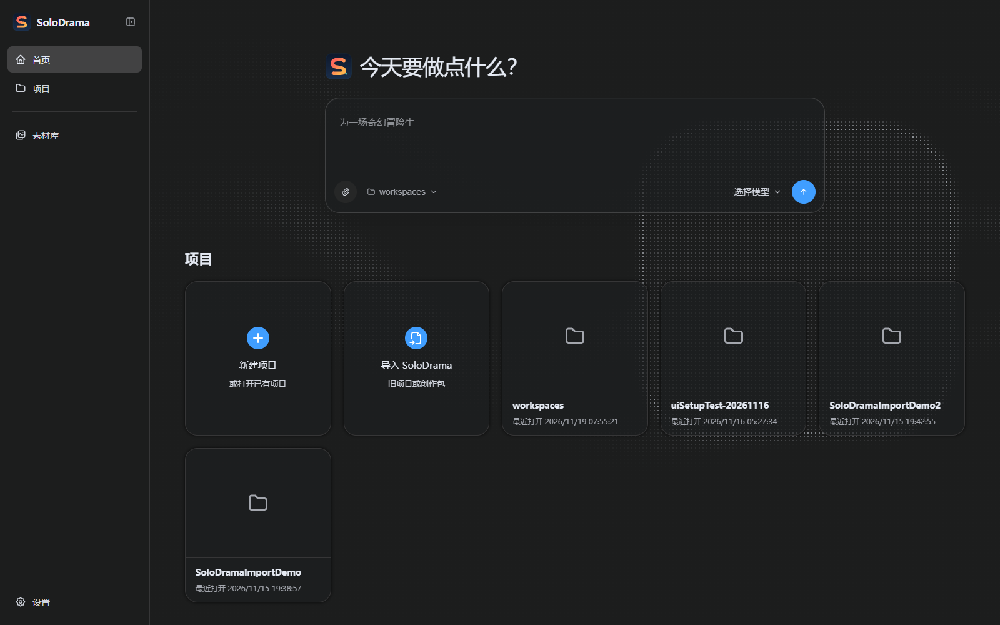
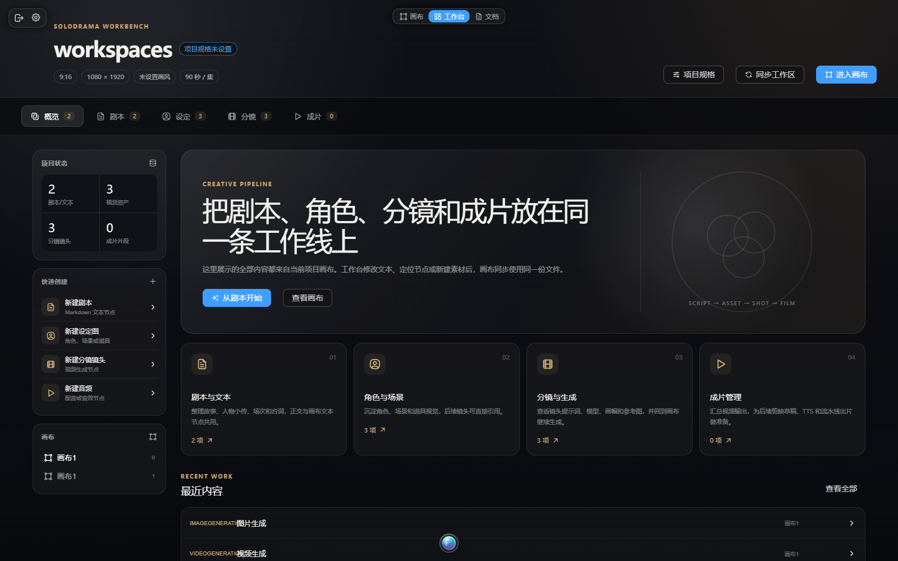

<div align="center">
  
  <h1>SoloDrama</h1>
  <p><strong>让短剧从剧本、分镜、生成一路走到成片</strong></p>
  <p>画布 · 工作台 · 文档 · 资产 · Agent · Skills · 插件</p>
</div>

SoloDrama 是一套面向竖屏短剧和连续内容生产的 AI 创作平台。它把项目规格、剧本、角色与场景资产、分镜、图片生成、视频生成、配音、粗剪、封面和发行准备放在同一个工作空间里。

既可以用来快速试验一个镜头，也可以围绕完整项目持续组织剧集、素材和生成任务。

## 界面预览

### 项目首页

从一句话开始创建项目，也可以打开本地目录或导入旧 SoloDrama 创作包。



### 项目工作台

工作台按“剧本、设定、分镜、成片”组织项目，并直接读取画布中的文本、资产和生成节点。



### 无限画布

文本、图片素材、图片生成、视频素材、视频生成、音频生成和 3D 导演台都可以在同一张画布中组合。


### 媒体模型

本地 ComfyUI、云端 ComfyUI、RunningHub、优云智算和 TTS 都在媒体模型页统一管理。


### 文本模型

支持 OpenCode Go、Command Code、DeepSeek、自定义 OpenAI 兼容服务和本地模型。


### 创作插件

内置项目预算、剪映草稿、封面设计、流水线出片、工作区文件和联网搜索等插件。


## 核心功能

### 从创意到成片的一体化项目空间

- 项目级画幅、分辨率、画风、台词语言、导演 Skill、集数、时长和帧率
- 剧本、设定和分镜文档直接进入画布文本节点
- 项目工作台与画布、文档和资产共用同一份工作区数据
- 支持单镜头试验，也支持多剧集连续生产

### 完整的画布节点体系

- 文本、图片素材、视频素材、音频素材节点
- 图片生成、视频生成、音频生成节点
- 3D 导演台和逐帧拉片
- 节点间支持文本、图片、视频和音频引用
- 生成任务支持取消、失败反馈和恢复查询

### 图片创作

- 文生图、单图编辑和多参考图编辑
- 角色四视图：脸部特写、正面全身、侧面全身、背面全身
- 角色设定卡
- 通用提示词增强和 H3 Image 增强
- 画风继承、局部重绘、打光、多角度和全景编辑入口

### 视频创作

- 文生视频、首帧、首尾帧和多模态参考
- 通用提示词增强
- H3 视频两阶段提示词增强
- 参考图顺序和生成参数可视化配置
- 支持 Seedance、H3、Krea2、Moss、Pika 加速工作流等模型能力

### 配音与音频

- OpenAI TTS 兼容接口
- 本地或自建 IndexTTS 2.5
- 音色、语速、情绪、表演说明和时长控制
- 项目台词语言自动传递给音频生成节点

### Agent、Skills 与 Tools

- Agent 可以读取项目、节点、文档和素材上下文
- Skills 支持导入、启用、编辑和项目级导演约束
- Tools 可访问文件、画布、浏览器、网络、FFmpeg 和资源库
- 支持把技能和工作流沉淀为可复用创作能力

## 模型接入能力

### ComfyUI

支持本地、局域网和云端 ComfyUI。

- 一个通道可维护多套命名工作流
- 支持文生图、图像编辑和视频模型
- 支持参考图上传、输入映射、任务轮询、结果下载和恢复
- 支持 H3 六参考图槽
- 可直接导入 ComfyUI 界面工作流 JSON，自动转换并识别输入映射
- 兼容已有 API 格式工作流 JSON

云端实例入口：

- [仙宫云](https://www.xiangongyun.com/register/PNLH4L)
- [优云智算](https://passport.compshare.cn/register?referral_code=2UZNw7j4pcEExqFlumDrU)

### RunningHub

支持 RunningHub AI App 和闭源模型两条接入路径。

- AI App：一个通道配置多个应用，自动读取输入字段并映射提示词和参考素材
- 闭源模型：Seedance 2.5 Flash、Seedance 2.5、Seedance 2.0、GPT Image 2.6 Flare
- 支持国内站和国际站
- 支持任务轮询、下载、取消、恢复和余额查询

站点入口：

- [RunningHub 国内站](https://www.runninghub.cn?inviteCode=cn-v1122)
- [RunningHub 国际站（宽审核）](https://www.runninghub.ai/zh-cn?inviteCode=rh-v1727)

### 优云智算

支持图片、视频和多模态模型接入，并可配置多个模型通道。

入口：[优云智算](https://passport.compshare.cn/register?referral_code=2UZNw7j4pcEExqFlumDrU)

### 文本模型

统一使用 OpenAI Chat Completions 兼容协议。

- OpenCode Go
- Command Code
- DeepSeek
- 自定义 OpenAI 兼容服务
- Ollama 和其他本地模型

### TTS

- OpenAI TTS 兼容服务
- 本地 IndexTTS 2.5
- 第三方语音 API
- 音色、语速、情绪、格式和采样率配置

## 后期制作

### 剪映草稿

支持逐集草稿和整季合并草稿，可包含视频轨、逐镜配音、旁白、字幕和 BGM。

### 流水线出片

按镜头顺序统一规格并合成成片，支持逐镜配音、整段旁白、BGM、字幕和封面。

### 封面设计

使用现有图片或图片模型生成底图，并叠加标题、副标题、描边和阴影。

### 项目预算

按项目记录预算、真实成本、未知费用和余额变化。

## 旧项目导入

可以把旧 SoloDrama 项目中的剧本、分镜、角色、场景、道具、分镜图、视频和参考图关系导入为新的画布项目。

```powershell
python migration/import-solodrama-project.py `
  --source "D:\path\to\old-solodrama" `
  --output "D:\path\to\new-solodrama-project"
```

导入为单向迁移，不会回写旧项目。

## 运行项目

环境要求：

- Bun 1.4.3
- 可选 FFmpeg，用于配音拼接、视频处理和流水线出片

```powershell
bun install --frozen-lockfile
bun run build:server
bun run start:server
```

启动后访问：

```text
http://127.0.0.1:3000
```

## 适用场景

- 竖屏短剧和漫剧
- AI 分镜与动态分镜
- 角色设定和多视图资产
- 多参考图视频生成
- 本地 ComfyUI 工作流生产
- 多供应商模型聚合
- 从分镜到剪映草稿和成片的完整流程
