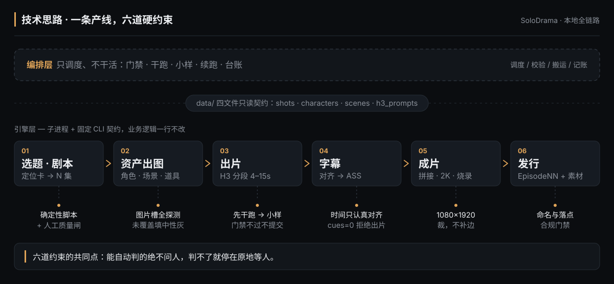
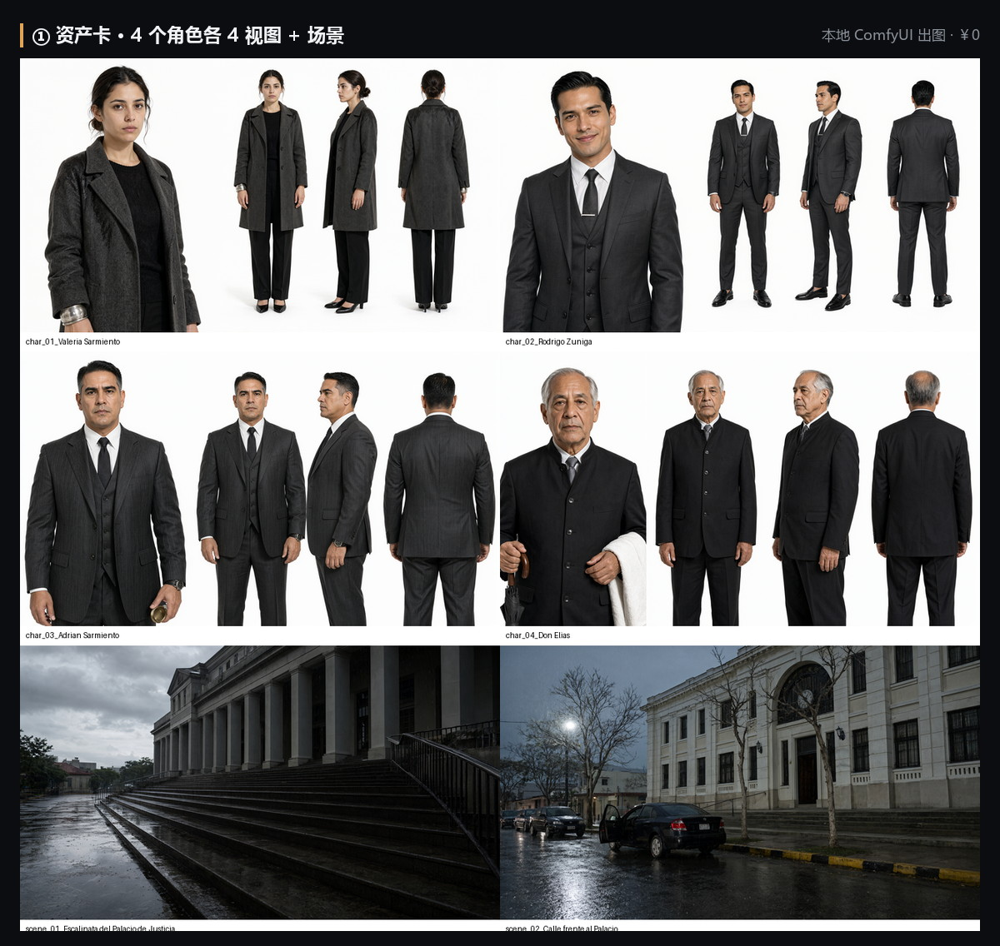
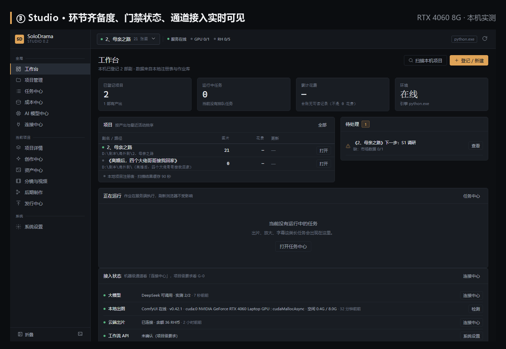

<p align="center">  
    
</p>

# SoloDrama

**一个人，就是一个剧组。**

把一部竖屏短剧从「一句话选题」推到「可发行成片」的本地全链路引擎：  
资产出图默认 **￥0**，云端出片逐笔可核，字幕时间只认强制对齐，交付规格不过关就不许导出。

全程在一台 **RTX 4060（8G 显存）+ 16G 内存的笔记本**上开发并验证 —— 不需要工作站、服务器或云主机。

 -3776AB.svg) 

---

## 它解决什么问题

短剧量产的成本不在「生成一段 5 秒视频」，而在这段 5 秒要重复几百次、每次都不能偏。

| 断裂点     | 具体现场                                                          | 不处理会怎样                                                |
| ------- | ------------------------------------------------------------- | ----------------------------------------------------- |
| **产能**  | 一集 60 秒 = 6–10 个生成段 + 20–40 张资产图 + 分镜 / 台词 / 字幕 / 封面，跨 11 个环节 | 每集都要人肉串，串错一步整集返工                                      |
| **一致性** | 角色跨集换脸、跨镜换衣服；参考图槽位残留，上一集的场景串进下一集                              | 观众认不出是同一个人，投放即掉                                       |
| **成本**  | 云端按次计费，跑错一步重跑整批；同样的时长，段数拆得越碎越贵          | 账单事后才看见，逐笔核对无从下手                                    |
| **交付**  | 发布版叫 `EP01_1080p_ES.mp4`、资产混进成片目录、9:16 靠补边凑                   | 平台判规格不符，人工复核一次发现一次                                    |

这四件事都不是「模型不够好」，是流程缺工程约束。所以本仓库大部分代码不在写提示词，在写门禁、校验与台账。

---

## 技术思路

**一条产线，六道硬约束。** 每个环节都有人替你把关，判不过就停在原地，不往下走。



*上：编排层只调度、不干活（门禁 / 干跑 / 小样 / 续跑 / 台账）；中：两层之间只有 `data/` 四文件这一份只读契约；下：六个环节各带一条硬约束。*

图的背后，三个反直觉的设计最能说明取舍：

- **门禁不只拦「没确认」，还拦「确认了 A、跑了 B」** —— 确认单落盘后换通道会被要求先改单，防的是默认值静默生效。画风同理，且不可事后更换。
- **字幕只认对齐结果，不认剧本估算** —— `cues=0` 直接拒绝出片；旧行为会静默烧出无字幕视频还叫 `_subbed.mp4`，和「已加字幕」从文件名上分不出来。
- **672×1216 到 1080×1920 靠裁，不靠补边** —— 补边在本地 `cropdetect` 里是满幅、查不出来；到平台按显示比例适配，黑边立刻出现。

<details>
<summary>六道约束落在哪个文件（给读代码的人）</summary>

| 约束 | 落点 |
| --- | --- |
| 只读契约：`data/` 四文件 | `stages/video/workflow/references/data-schema.md` |
| 门禁：未过即停（退出码 4） | `stages/production/scripts/pipeline.py` |
| 本地出图 + 图片槽全探测 | `stages/assets/comfyui/` |
| 字幕强制对齐（`cues=0` 拒绝出片） | `stages/subtitle/` |
| 交付规格：crop-to-fill，不补边 | `stages/production/scripts/delivery_spec.py` |
| 花钱四条闸：干跑 / 小样 / 续跑 / 台账 | `stages/production/scripts/cost_model.py` |

</details>

---

## 案例效果

以下全部来自实跑工作区，不是渲染图，也不是估算。



*图 1 · 资产卡：4 个角色各 4 视图（正 / 侧 / 背 / 特写）+ 场景。四视图是后续所有镜头的共同锚点——换集不换脸靠它，不靠运气。*


*图 2 · 同批分镜的 3 段原帧（672×1216）。台阶 → 雨夜的车 → 车内：同一件大衣、同一场雨、同一张脸。字幕在整集母版阶段烧录，这里看的是出片原帧。*



*图 3 · Studio 工作台：项目、待办、通道接入一屏可见。界面上的每个数字都来自引擎的真实产物，没有假按钮。*

| 实跑项目 | 实测规模与产出 |
| --- | --- |
| 《离婚后，四个大佬哥哥接我回家》西语 · 竖屏 · 40 集 | ep02–ep40 共 39 集：**261 个生成段 / 1853 秒画面**（约 31 分钟），逐集出片并记台账 |
| 《七大姑催婚》ep03–ep10 | **64 段 / 172 条字幕 / 792 秒成片**，字幕全量烧录，按期交付 |
| 《贤妻不装了》 | 81/81 参考图全量出图 |
| 《La Novia del Enemigo》 | 西语竖屏端到端：源剧本 → 成片，含封面与发行资料 |

---

## 三分钟跑起来

```bash
git clone https://github.com/Hejunlong27/SoloDrama.git && cd SoloDrama
pip install -r requirements.txt     # 只装 httpx + Pillow，无其他第三方依赖
python tools/env_check.py           # 退出码 2 = 必需项缺失，先修环境再往下走
start.cmd                           # Windows 双击：挑解释器 / 找端口 / 开浏览器
```

不想敲命令，就把下面这段交给能读写本地文件、能执行命令的 AI 助手（WorkBuddy / Claude Code / Codex 皆可）；
尖括号里的内容换成你自己的，仓库路径填你实际克隆到的位置。

```text
用本机的 SoloDrama 仓库帮我把下面这个故事做成一部短剧（仓库路径：<填你的实际路径>）。

【故事】<把你的故事或小说粘在这里>
【平台】竖屏（TikTok / 红果风格）
【规格】30 集，每集约 60 秒

请走完整流程：选题 → 剧本 → 分镜与视频提示词 → 资产出图 → 渲染出片 →
拼接 2K → 字幕 → 成本台账。

硬性要求：
- 花钱的动作先报价、我同意后再执行；先出 1 段小样，我确认后再全量
- 人物 / 场景 / 道具资产一律放 04-资产，不要放进 07-成片
- 发布版一律 EpisodeNN.mp4 落 09-发行/剧集，用 release_export.py 导出，不手工改名
- 中断就用 --resume 续跑，不重复提交、不重复花钱
```

> **三条铁律**：不确认不花钱（计费动作默认干跑）· 先小样后全量 · 中断就续跑（`--resume`）。

非 Windows 环境可直接走 CLI：`python stages/production/scripts/drama.py status`。

**你是哪一类？** 内容团队 → [使用者路线](docs/operations/使用者路线.md)（三段提示词，全程不写代码）；  
开发者 → [开发者路线](docs/operations/开发者路线.md)（离线用例、四份契约、扩展点与改动红线）。

---

## 仓库结构

```
SoloDrama/
├── stages/
│   ├── creation/         创作链路：① 调研对比 → ② 爆款拆解 → ③ 选题定位 → ④ 剧本改写
│   ├── assets/           资产出图：提示词净化 + 三类模板 + md→清单转换
│   │   └── comfyui/      ★ 本地 ComfyUI 出图引擎（￥0、零第三方依赖、不出网）
│   ├── video/workflow/   批量出片（RunningHub 工作流 / AI 应用）
│   ├── subtitle/         字幕与成片：对齐 → ASS → 拼接 → 2K → 烧录 → 七道断言
│   └── production/       一集总控：门禁 / 体检 / 调度 / 验收 / 成本台账 / 发行门禁
├── tools/                环境自检、创作层确定性工具
├── web/                  本地 Web 控制台（FastAPI + 原生 JS，零构建；删掉即回滚）
├── docs/                 单一真源文档：流程总纲 / 画风三轨 / 发行资料 / 合规 / 创作方法论
├── configs/              配置模板（含 model-plan.example.json 模型确认单）
├── start.cmd             双击启动 Studio
├── manifest.sha256       引擎文件指纹（防篡改 / 防漂移）
└── VERSIONS.md           版本记录与改动清单
```

## 配置与密钥

平台密钥一律走环境变量，代码与模板里不落任何真实 Key（本地 ComfyUI 通道不需要任何 Key）。

| 变量                                                    | 用途                                  |
| ----------------------------------------------------- | ----------------------------------- |
| `RUNNINGHUB_API_KEY` / `RUNNINGHUB_BASE_URL`          | 云端出片（消费级；按账号所在站点填）                  |
| `RUNNINGHUB_ENT_API_KEY`                              | 企业级-共享；仅标准模型 API                    |
| `RH_CHAR_APP_ID` / `RH_SCENE_APP_ID`                  | 账号绑定的 AI 应用 ID                      |
| `SOLODRAMA_WORKSPACE` / `SOLODRAMA_ASSET_MD`          | 默认工作区 / 资产提示词 md（旧前缀 `DRAMA_*` 仍生效） |
| `COMFYUI_URL` / `COMFYUI_NODE_*` / `COMFYUI_WORKFLOW` | 本地出图地址与节点映射（换工作流改配置不改代码）            |

运行配置唯一可写文件是 `<工作区>/config.local.json`；引擎代码与剧项目数据严格分离，`data/`、`output/`、台账一律落工作区。

## 环境要求

| 项                | 必需                 | 说明                         |
| ---------------- | ------------------ | -------------------------- |
| Python 3.10+     | ✅                  | 实测 3.13                    |
| Pillow / httpx   | Pillow ✅ · httpx ⭕ | 封面排版、图像体检 / 云端通道           |
| ffmpeg / ffprobe | ✅                  | 拼接、2K、字幕烧录、像素验收            |
| NVIDIA 独显        | ⭕                  | 有：本地出图 ￥0；无：全部走云端，照样能跑     |
| ComfyUI          | ⭕                  | 未启动时 Studio 会自动拉起（30–90 秒） |

自检不过、或需要「装错解释器」这类高频坑的修法，见 [环境自检](docs/operations/环境自检.md)。

---

## 文档地图

| 主题                                        | 文档                                                                                                                                                                |
| ----------------------------------------- | ----------------------------------------------------------------------------------------------------------------------------------------------------------------- |
| **生产流程总纲（流程 · 目录规范 · 硬规则 · 门禁）★ 单一真源**    | [`docs/orchestration/生产流程总纲.md`](docs/orchestration/生产流程总纲.md)                                                                                                    |
| **画风三轨规范（画风 / 资产规格）★ 单一真源**               | [`docs/styles/画风三轨规范.md`](docs/styles/画风三轨规范.md)                                                                                                                  |
| **叙事结构（剧本解析 / 分镜 / 台词 / H3 提示词）· 对白驱动**   | `3d-short-drama-studio` 技能（`references/dialogue-driven-rules.md`）                                                                                                 |
| **新项目启动提示词（复制给 AI 助手即可）**                 | [`docs/新项目启动提示词.md`](docs/新项目启动提示词.md)                                                                                                                            |
| 使用者路线：安装 / 做剧 / 发行三段提示词 + 命令行速查           | [`docs/operations/使用者路线.md`](docs/operations/使用者路线.md)                                                                                                            |
| 开发者路线：离线自检 / 契约 / 扩展点 / 改动红线 / 配置         | [`docs/operations/开发者路线.md`](docs/operations/开发者路线.md)                                                                                                            |
| 环境自检：检查项、三种典型失败与修法                        | [`docs/operations/环境自检.md`](docs/operations/环境自检.md)                                                                                                              |
| 项目档案：交付清单 / 能力矩阵 / 平台硬限 / 实现历程            | [`docs/operations/项目档案.md`](docs/operations/项目档案.md)                                                                                                              |
| 角色差异化设计规范（六维签名 · 六条硬规则）★                  | [`docs/assets/角色差异化设计规范.md`](docs/assets/角色差异化设计规范.md)                                                                                                            |
| 发行资料清单（封面抓马度 · 版权资料 4+4 · 发布清单）★          | [`docs/distribution/发行资料清单.md`](docs/distribution/发行资料清单.md)                                                                                                      |
| 发布前合规预检清单（TikTok 口径）                      | [`docs/compliance/发布前合规预检清单.md`](docs/compliance/发布前合规预检清单.md)                                                                                                    |
| 画面合规与交付规格（黑边 / 品牌 / 字幕证据链）                | [`docs/compliance/画面合规与交付规格.md`](docs/compliance/画面合规与交付规格.md)                                                                                                    |
| 剧本改编四段法 / 剧本强度工程 / 台词时长审计口径               | [`docs/creation/`](docs/creation/)                                                                                                                                |
| 落点与命名事故复盘（必读） / 踩坑清单 / 产线对账关卡             | [`docs/patches/`](docs/patches/)                                                                                                                                  |
| Studio 工作台说明（启动 / 页面能力矩阵 / LLM 系统 / 安全边界） | [`web/STUDIO.md`](web/STUDIO.md)                                                                                                                                  |
| 架构、数据契约、执行流程                              | [`docs/Agent项目技术文档.md`](docs/Agent项目技术文档.md)                                                                                                                      |
| 出片数据契约 / RunningHub 行为契约 / 生产总控坑册         | [`stages/video/workflow/references/`](stages/video/workflow/references/) · [`stages/production/references/pitfalls.md`](stages/production/references/pitfalls.md) |

## License

以 **Apache-2.0** 开源，详见 [LICENSE](LICENSE)。版本记录与每次改动的根因复盘见 [VERSIONS.md](VERSIONS.md)。
