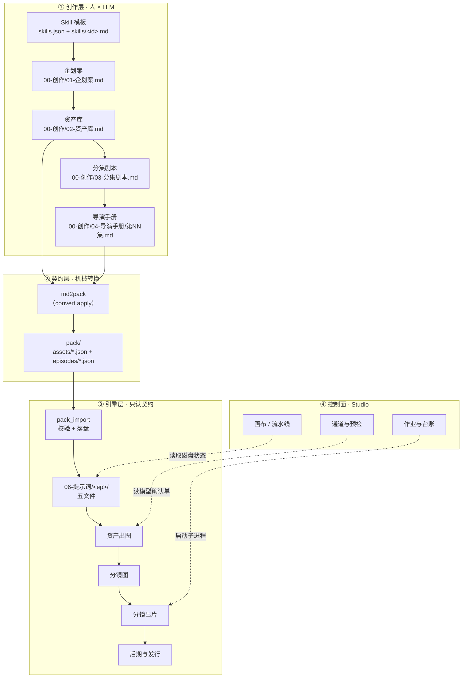
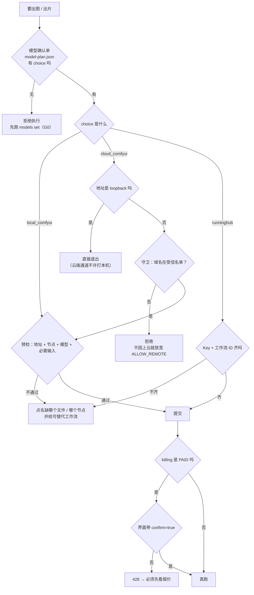

  

# SoloDrama

**把一句话点子做成可发布竖屏短剧的流水线。**

创作交给可插拔的题材模板，执行交给本机或云端的 ComfyUI，两者之间只隔一份文件契约 ——
所以换一套题材模板，引擎一行不用改。

---

## 四层结构

创作只写 markdown，引擎只读 JSON。层与层之间传文件，不传内存状态。

## 全景

```mermaid
flowchart LR
    subgraph C["创作"]
        N1["1 创作模板"]
        N2["2 灵感"]
        N3["3 企划案"]
        N4["4 资产库"]
        N5["5 剧本"]
        N6["6 导演手册"]
    end
    subgraph E["契约与引擎"]
        N7["7 转换"]
        N8["8 制作包"]
        N9["9 导入"]
        N10["10 绑定参考图"]
        N11["11 生成端门禁"]
        N12["12 资产出图"]
        N13["13 分镜图"]
        N14["14 出片解析"]
        N15["15 批量出片"]
        N16["16 出片审计"]
    end
    subgraph P["后期"]
        N17["17 母版"]
        N18["18 放大"]
        N19["19 字幕"]
        N20["20 合规"]
        N21["21 发行导出"]
    end

    N1 --> N3
    N2 --> N3
    N3 --> N4 --> N6
    N3 --> N5 --> N6
    N4 --> N7
    N6 --> N7
    N7 --> N8 --> N9 --> N10 --> N11
    N10 --> N12 --> N13
    N13 --> N14 --> N15 --> N16
    N16 --> N17 --> N18 --> N19 --> N20 --> N21
```

## 生成通道

三条路，同一个执行器、同一套预检。通道只从「模型确认单」读一次，界面与命令行不会各有各的答案。

---

## 效果

*4 个角色各 4 视图。四视图是后续所有镜头的共同锚点 —— 换集不换脸靠它。*

*同批分镜的 3 段原帧（672×1216）：同一件大衣、同一场雨、同一张脸。*

*Studio：项目、待办、通道状态一屏可见。每个数字都来自引擎的真实产物。*

---

## License

[Apache-2.0](LICENSE)
