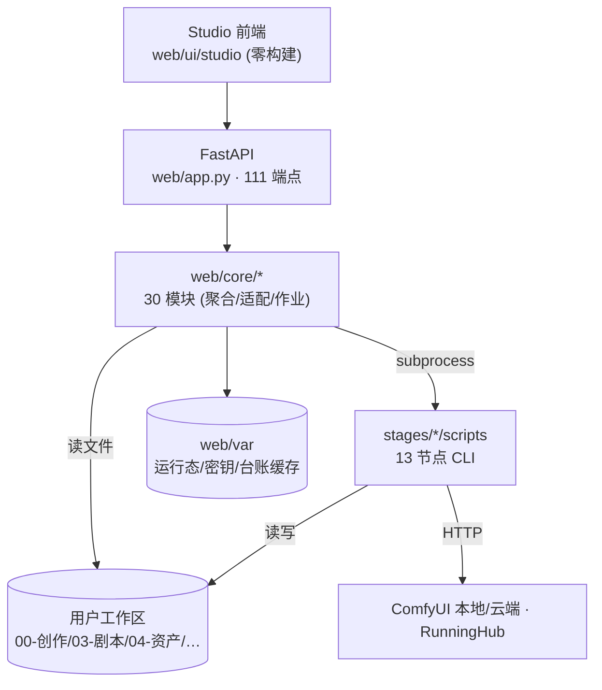

# 当前架构（SoloDrama · 审计基线）

> 基线：`main` @ `2347df2`，工作树干净。取证时间 2026-11-10。
> 本文是**正式交付位置**；逐条命令输出与行号见 `docs/upgrade/01-current-architecture.md`（证据集）。

## 1. 技术栈（实测，不是推测）

| 层 | 技术 | 事实依据 |
|---|---|---|
| 前端 | 原生 ES Module + CSS，**零构建**（无 npm / 无打包器 / 无 node_modules） | `web/ui/studio/index.html` 直接 `<script type="module">` |
| 后端 | FastAPI `0.143.3` + uvicorn `0.54.0`（`web/requirements-web.txt`） | 111 个端点 |
| 引擎 | Python 3.13 脚本，**独立进程**，不 import 进 Web | `web/core/adapters.py:64` 起子进程 |
| 存储 | 文件系统为唯一数据源；`sqlite3` 仅用于作业库/审计/事件流 | `web/core/jobs.py`，标准库 |
| HTTP 客户端 | httpx `0.28.1`（与引擎锁定同版本） | `requirements-web.txt` |
| 外部能力 | 本地 ComfyUI(8188)、云端 ComfyUI、RunningHub | `web/core/comfy_*.py`、`cloud/` |

**没有数据库。** 所有业务数据在工作区的 Markdown / JSON 里。

## 2. 分层与边界（2.0 不可破坏）

三条铁律：

1. **Web 不 import 引擎**（`grep "from stages"` 零命中）。新增能力 = 复用或新增脚本 + 子进程。
2. **路径不由前端拼**。真源两处：引擎侧 `stages/_layout.py`，控制台侧 `web/core/studio.py`。
3. **零构建**。`_FreshStatic` + 版本查询串是防缓存事故的既有修复，换构建链会丢掉它。

## 3. 四层职责

| 层 | 位置 | 产出 |
|---|---|---|
| 创作层 | `stages/creation/skills/`、`web/core/{creation,skills}.py`、`web/core/llm/` | `00-创作/`、`03-剧本/` 的 Markdown |
| 契约层 | `stages/import/{md2pack,pack_spec,pack_import,h3_prompt,prompt_marks}.py` | `pack/*.json`、`data/*.json` |
| 引擎层 | `stages/{assets,production,edit,subtitle,video}/scripts/`、`cloud/` | `04/05/06/07/08/09-*` 产物 |
| 控制层 | `web/app.py`、`web/core/`、`web/ui/` | 只读聚合 + 作业调度 |

## 4. 运行形态

| 形态 | 入口 | 端口 | 约束 |
|---|---|---|---|
| 生产（默认） | `start.cmd` | 8788 | 全能力 |
| 只读 | `start-readonly.cmd` → `--readonly` | 8788 | `SOLODRAMA_CONSOLE_READONLY=1`，后端 423 |
| 演示（规划） | `SOLODRAMA_STUDIO_MODE=demo` | — | `[待核实: docs 提到但仓库未发现 demo 目录]` |

## 5. 关键目录抽象

`web/core/studio.py`：`out_dir` `data_dir` `script_dir` `assets_dir` `release_dir` `engine_root`。
`stages/_layout.py::STAGE_DIRS`：`03-剧本 04-资产 05-分镜 06-提示词 07-成片 08-合规 09-发行`。
`layout.json` 的 `stages` 可覆盖目录名 → **UI 绝不能硬编 `04-资产`**。

## 6. 已知架构级问题（详见 technical-debt.md）

| 编号 | 问题 | 严重度 |
|---|---|---|
| T1/T2 | 两套配色并存 + 72 处硬编码色值 | 阻塞浅色主题 |
| T3/T4 | 提示词拍平成单串、无写回接口 | 阻塞分镜工作台 |
| T5 | `data/h3_prompts.json` 与 `06-提示词/` 双份未定源 | 高风险（静默失效） |
| T6 | 一级导航 15 项平铺 | 阻塞信息架构 |
