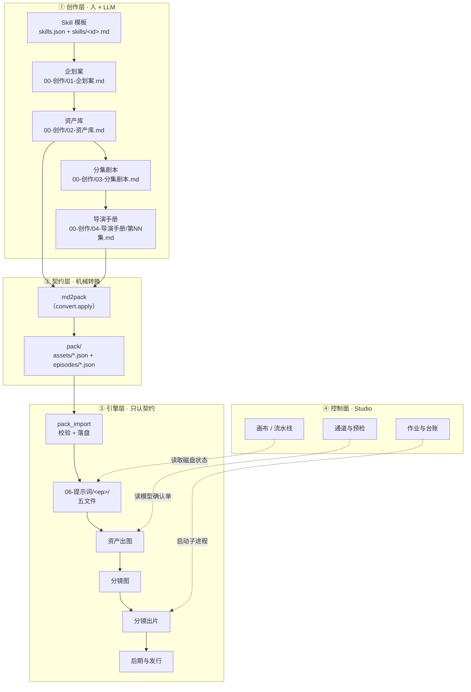
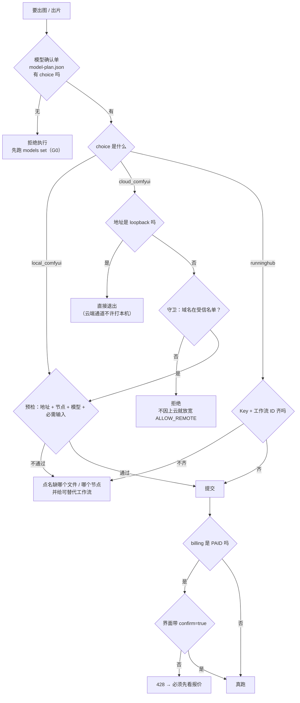
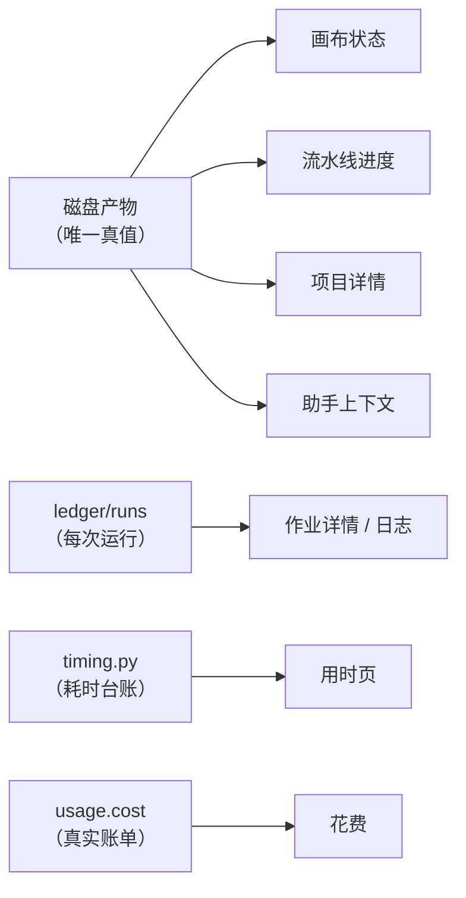

# SoloDrama 工作流程报告

> 复盘日期：2026-11-05 ｜ 版本基线：V0.7.63 ｜ 口径：以仓库代码与实跑产物为准，不以计划文档为准
> 配套：《检查分析报告》同目录 `检查分析报告.md`；可视化总览 `index.html`

---

## 0. 一页纸

SoloDrama 是一条**「一句话点子 → 可发布竖屏短剧」**的批处理流水线。它的核心设计不是"把 AI 串起来"，而是**把创作与执行切开，中间只留一份文件契约**。

```
创作层（人来主导 · 产出 markdown）
   ↓  md2pack：机械转换，不改一个字
契约层（pack/*.json：唯一交换格式）
   ↓  pack_import：校验 + 落盘 + 回填参考图
引擎层（data/*.json：唯一输入契约 · 只认代号）
   ↓  预检 → 提交 → 轮询 → 续传
生成层（本地 ComfyUI / 云端 ComfyUI / RunningHub）
   ↓  final.mp4
后期层（母版 → 放大 → 字幕 → 合规 → 发行）
```

**一句话概括节点之间的衔接方式**：不靠函数调用、不靠内存状态传递，靠 **磁盘上的文件**。每一步的输入是上一步的产物文件，每一步的状态由该文件是否存在来判定。这条选择的代价是"重复解析"，收益是**任何一步都能单独重跑、任一步失败都不会污染上游**。

| 维度 | 数字 |
|---|---|
| 画布节点 | 18（创作 6 + 引擎 12） |
| 可执行命令 | 48 |
| 阶段目录 | 9 个编号目录 + 1 个技术目录 |
| 代码 | Python 183 文件 / 6.15 万行；JS 33 文件 / 0.97 万行 |
| 测试 | 427 例（引擎 103 + Studio/导入/视频/云/字幕/工具 324） |
| 实跑单镜成本 | 本地 ￥0 / 4s 镜 160s；云端 ￥1.59/时；RH 27 币 + 1 币/秒 |

---

## 1. 四层结构



**分层纪律（实际执行，不是口号）**

| 层 | 能写什么 | 不能做什么 | 违反的后果 |
|---|---|---|---|
| 创作层 | 只写 `00-创作/*.md` | 不写提示词 JSON、不改引擎配置 | 无（最坏是白写） |
| 契约层 | 只写 `pack/` | 不改台词、不补写提示词 | 缺口报告里逐条列 |
| 引擎层 | 只写 `04-资产`、`06-提示词`、`07-成片`、`09-发行` | **不解析 markdown** | 一旦解析，创作层改格式就会崩掉引擎 |
| 控制面 | 只读磁盘 + 起子进程 | 不在内存里维护"进度真值" | 重启 Studio 后状态就错乱 |

这套纪律的唯一硬后果：**引擎永远不知道"导演手册长什么样"**。所以 Skill 换一套模板，引擎完全不用改——这是整个项目最重要的结构性收益。

---

## 2. 主链路（18 节点逐个说清衔接）

### 2.1 全景

```mermaid
flowchart LR
    subgraph C["创作"]
        N1["1 创作模板"]
        N2["2 灵感"]
        N3["3 企划案"]
        N4["4 资产库"]
        N5["5 剧本"]
        N6["6 导演手册"]
    end
    subgraph E["契约与引擎"]
        N7["7 转换"]
        N8["8 制作包"]
        N9["9 导入"]
        N10["10 绑定参考图"]
        N11["11 生成端门禁"]
        N12["12 资产出图"]
        N13["13 分镜图"]
        N14["14 出片解析"]
        N15["15 批量出片"]
        N16["16 出片审计"]
    end
    subgraph P["后期"]
        N17["17 母版"]
        N18["18 放大"]
        N19["19 字幕"]
        N20["20 合规"]
        N21["21 发行导出"]
    end

    N1 --> N3
    N2 --> N3
    N3 --> N4 --> N6
    N3 --> N5 --> N6
    N4 --> N7
    N6 --> N7
    N7 --> N8 --> N9 --> N10 --> N11
    N10 --> N12 --> N13
    N13 --> N14 --> N15 --> N16
    N16 --> N17 --> N18 --> N19 --> N20 --> N21
```



> 画布上是 18 个节点；上图为叙事视角，把 `import.*` 三个子步骤展开成 3 个，因此 21 步。

### 2.2 每一步：输入 → 执行 → 产物 → 卡点

| # | 节点 | 输入（谁给我） | 执行器 | 产物（给谁） | 卡住时 |
|---|---|---|---|---|---|
| 1 | 创作模板 | 用户选择 | `core/skills.py` | `skills.json` + `skills/<id>.md` | 单选；再装会替换 |
| 2 | 灵感 | 一句话 + 集数时长 | WebUI 表单 | `brief.json` | 空 → 企划案无法生成 |
| 3 | 企划案 | 模板 + 灵感 | `llm.gateway` → `create.plan` | `00-创作/01-企划案.md` | 分批模板需续写 |
| 4 | 资产库 | 企划案 | `create.assets` | `00-创作/02-资产库.md` | 4 批，一次一批 |
| 5 | 剧本 | 企划案 | `create.script` | `00-创作/03-分集剧本.md` | 一次一集 |
| 6 | 导演手册 | 资产库 + 剧本 | `create.director` | `00-创作/04-导演手册/第NN集.md` | **4–5 镜/批**（8 镜撞 8k 输出上限） |
| 7 | 转换 | 资产库 + 导演手册 | `stages/import/md2pack.py` | `pack/` + `_import_report.md` | 缺提示词的资产/镜头 → 报告里逐条列 |
| 8 | 制作包 | 转换产物 | 同上 | `pack/assets/{characters,scenes,props}.json`、`pack/episodes/epNN.json` | schema 严格，缺字段直接 FAIL |
| 9 | 导入 | 制作包 | `pack_import.py --apply` | `06-提示词/<ep>/` 五文件 + `04-资产/refs.json` | 缺集/缺资产引用/缺 `video_prompt` 全阻断 |
| 10 | 绑定参考图 | `04-资产/{characters,scenes,props}/` | `pack_import` 回填 | `refs.json` 里每条的绝对路径 | 图还没出 → 先出图再回填 |
| 11 | 生成端门禁 | `06-提示词/<ep>/` | `ingest.check`（G7） | `_done/ingest.json` | 参考图缺失、槽位超限 |
| 12 | 资产出图 | `pack/assets/*.json` | `gen_assets_local.py` | `04-资产/{kind}/<id>_<name>[_<variant>]_00.png` | 缺模型 → 预检点名到文件名 |
| 13 | 分镜图 | `shots.json` + 资产图 | `board.frame` | `04-资产/boards/<ep>/shot_NNN.png` | 每镜一张 9:16 首帧 |
| 14 | 出片解析 | `shots.json` | `comfy_batch_video.py`（干跑） | 计划：镜号 / 时长 / 比例 / 参考图张数 | `--workflow` 决定核哪一份 |
| 15 | 批量出片 | 计划 + 参考图 | `comfy_local_video.py` | `video-pipeline/output/<ep>/shot_NNN/final.mp4` | 退出码 3 = 批次缺口 |
| 16 | 出片审计 | 逐段成片 | `video.audit` | `_done/video.json` + 报告 | 帧数不足 98% 触发重编码 |
| 17 | 母版 | 逐段成片 + 封面 + BGM | `media.master` | `07-成片/<ep>/master.mp4` | 帧数校验 |
| 18 | 放大 | 母版 | `media.upscale` | `<ep>_master_<W>x<H>.mp4` | RH / Topaz / 跳过 |
| 19 | 字幕 | 母版 + `03-剧本` 台词 | `media.render` | `_subbed.mp4` + `_normdelivery.mp4` | **cues=0 直接拒绝出片** |
| 20 | 合规 | 交付版 | `compliance_media_check.py` | `08-合规/` 报告 | C1 规格 / C2 黑边 / C3 字幕 / C4 品牌 |
| 21 | 发行导出 | 交付版 + 发行资料 | `release_export.py --all --apply` | `09-发行/剧集/EpisodeNN.mp4` | 六抓手 ≥5/6、版权资料 01–04 连续 |

### 2.3 三处"看起来能接、其实接不上"的地方（已修）

| 现象 | 根因 | 现在 |
|---|---|---|
| Skill 模板写"第N批/共M批"，界面点两次只得到第 2 批 | 写盘是整份覆盖 + 没把上一批喂回去 | `write(append=True)` + `vars_for` 注入 `prior/batch_no/shot_from` |
| 导演手册末镜缺 `video_prompt` | 8 镜 ≈ 8k tokens 撞输出上限，末镜围栏不闭合 | 一镜/批降到 4–5，透出 `finish_reason`，截断当场报警 |
| 竖屏项目出成横屏 | 批次只传全局 `--aspect`，镜头级 `ratio` 从未生效 | 按 `shots[].ratio` 查 **ComfyUI 实际枚举**下传 |

---

## 3. 生成通道：三条路，一个读取点



**关键决策：通道选择的唯一读取点是 `core/generators.py::plan_choice(ws, kind)`。**
流水线的 `STAGE_MAP`、画布节点的运行按钮、通道页的云端行，三处都调它，不各读一次。理由很直白：同一件事读三次必然分叉——上一轮就出现过"界面说云端、跑起来是本机"。

**云端任务级启停**（`cloud/session.py::Lease`）：`auto` 模式下 复用 → 借 → 开机 → 新建，跑完立刻停，且**只停自己拥有的**。失败和 Ctrl-C 同样走停机。`cloud reap` 兜底清 15 分钟空闲实例。

---

## 4. 门禁体系：按"产物齐备度"判，不按"做过没有"判

```
G-0 环境自检 → G0 通道确认 → G1 布局 → G3 制作包校验
   → G2 导入 → G4 生成端 → G5 出片 → G6 后期
   → G7 入 data 门禁 → G8 合规 → G11 发行
```

| 门禁 | 判据真源 | 不过的表现 |
|---|---|---|
| G0 | `model-plan.json` 是否有该类 choice | 所有生成类命令拒绝执行 |
| G2 | `pack_spec.load_pack()` 的 report | 阻断并逐条列（缺集 / 缺资产 / 缺提示词） |
| G4/G5 | `gen_preflight.check()`：守卫 → 在线 → 版本 → 节点 → 模型 → 必需输入 | 点名到 `.safetensors` 全名，并给替代工作流 |
| G7 | `ingest.check` | 参考图缺失、槽位超限 |
| G8 | `compliance_media_check.py` C1–C4 | 导出被拦 |

**一条纪律**：门禁只看**齐备度**，不看质量。S6 按镜头去重，不判画面好坏。质量靠人抽检（`compliance` 的 C4 品牌项直接标 MANUAL）。这不是偷懒——机器判质量必然误判，误判会让人开始不信门禁，最后全绕过。

---

## 5. 一致性机制：五道锁

短剧的成本几乎全在"观众发现这不是同一个人"上。项目用了五层，从便宜到贵：

| 层 | 机制 | 落点 | 管什么 |
|---|---|---|---|
| 1 | **画风锁** `style_lock` | `project.json` + 每条提示词前缀 | 画风不可事后更换 |
| 2 | **角色锚点** `anchors` | `pack/assets/characters.json` | 4–6 个不可变特征（发式/瞳色/痣） |
| 3 | **参考图** `refs.json` | `04-资产/refs/` → `06-提示词/refs_h3/` | 具体长相 |
| 4 | **槽位守卫** `make_slot_guard` | `slots_<key>.json` | 未覆盖的图槽填 1024² 中性灰（`nodeInfoList` 是覆盖表，漏槽会串景 + OOM） |
| 5 | **文本连续性** 五锚 | `script_continuity.py` | `[SC-nn]` 镜号、台词前 24 字指纹、单句字数、时长 ±2s、只认 HEADER 登记的大写代号 |

第 5 层容易被低估：它管的是**剧本层面**的一致性（这个人这集叫崔昭，下一集不能变成崔氏），出错时观众未必说得出哪里不对，但会觉得"这剧廉价"。

---

## 6. 状态与可观测



**三条硬规矩**

1. **状态只认磁盘**。有 `_done/*.json` 且产物存在才算完成；反过来"产物在、标记缺"时画成完成并注一句"引擎判据未过"——两件事不合并，否则真实项目会整片红。
2. **金额只认 `usage.cost`**。预估只用于闸门，永不用"余额差值"倒推。
3. **耗时路径必须归一化去重**。同一段被两条路径记账会虚增，`timing.py` 负责这件事。

---

## 7. 数据流（文件级）

```
00-创作/02-资产库.md ─┐
00-创作/04-导演手册/ ─┴─→ pack/assets/*.json ─┬─→ 04-资产/{characters,scenes,props}/*.png
                     └─→ pack/episodes/*.json ─┤
                                              └─→ 06-提示词/<ep>/
                                                  ├ shots.json       → 出片
                                                  ├ boards.json      → 分镜图
                                                  ├ h3_prompts.json  → 出片提示词
                                                  ├ characters.json  ┐
                                                  └ scenes.json      ┘ 参考图绑定
03-剧本/ep_XX.md ─────────────────────────────→ 字幕（只取台词文本）
07-成片/<ep>/master.mp4 ──────────────────────→ 字幕 → _normdelivery → 09-发行/剧集/EpisodeNN.mp4
```

**唯一的"回头路"是参考图回填**：资产图先出，才能填进 `refs.json`，而 `refs.json` 又是出分镜图的输入。所以顺序只能是 **出图 → 回填 → 分镜图 → 出片**，不能并行。这也是"先只出一张看风格"（`--only`）唯一安全的用法。

---

## 8. 一轮真实运行的时间账（RTX 4060 8G）

| 步骤 | 单次耗时 | 占比 | 备注 |
|---|---|---|---|
| 资产出图 1 张 | 32s | — | 1440²，固定 seed 字节可复现 |
| 分镜图 1 张 | ~30s | — | 9:16 首帧 |
| 出片 1 镜 4s | 160s | **最大项** | 1056×608 / 24fps / 含音轨 |
| 出片 1 镜 9s | 308s | 最大项 | 480×864（竖屏精确 9:16） |
| 字幕对齐 + 烧录 | 分钟级 | 小 | 需真 ASR/CTC |
| 一集 10 镜 60s 片 | ≈ 50–55 分钟 | — | 纯生成时间，不含人审 |

**结论**：本机是 **≈40 倍实时**。这不是异常，是消费级显卡跑 2026 年视频模型的正常比值。它决定了本项目适合"慢工出细活/批量过夜"，不适合"当天出片"。

---

## 9. 与计划文档的偏差（诚实清单）

| 计划里有 | 实际状态 |
|---|---|
| 云端 ComfyUI 一键接入 | 代码全通，**实例侧仍待部署**（插件/模型/SSH 免密属另一任务） |
| RunningHub 两条通道 | 代码在、计费口径实测过，**用户主动暂缓** |
| 调研 / 选题两阶段 | **已删**，理由：那是创作不是引擎（`docs/BRANCH-ENGINE.md`） |
| 30 集 × 60s 默认 | 保留，但实际项目节奏是 10 镜 × 9s ≈ 92s（模板决定，不是引擎决定） |
| 图生图批量 | `comfy_client --image` 支持，**`drama assets --ref` 批量入口未接** |
| 对白配音 | **无 TTS 环节**。H3 出的是伴随音轨，不是可指定的台词配音 |

最后一行是本报告里最需要被看见的一条，详见《检查分析报告》§4。
